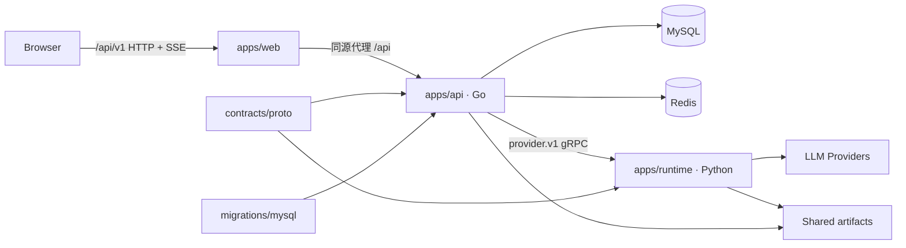

# Agent Task Platform

Agent Task Platform 是一个面向 AI Agent 工作流的多应用项目。目前提供统一的用户会话、Provider/模型配置、Agent 节点配置、文本流式生成，以及可恢复的 PPT 生成任务。Web、Go API 和 Python Runtime 分开部署；对外 HTTP API 以 `/api/v1` 为唯一推荐入口，Go 与 Python 之间使用仓库内统一维护的 gRPC 协议。

完整的 HTTP 与内部 gRPC 契约见 [docs/API.md](docs/API.md)。

## 核心能力

- JWT access/refresh token，Redis 会话、refresh token 与 access token 黑名单。
- Provider 目录、凭据连通性测试、按用户隔离的模型配置。
- Agent 定义与节点级模型绑定；节点可覆盖 temperature 和 max tokens。
- 文本生成 SSE。
- PPT 后台 Job：持久化状态、事件、操作、会话与版本化产物；支持刷新恢复、SSE 续传、取消、大纲/风格确认和单页重做。
- MySQL 增量迁移与启动时任务恢复。
- Vue 3 管理界面和 PPT 生成工作台。

## 总体架构



浏览器只访问 Go API。Go 负责认证、权限、持久化、公开接口和后台任务生命周期；Python Runtime 负责 Provider 调用与 PPT 工作流。PPT 文件由两个进程通过同一目录读写：Runtime 生成，API 在校验用户所有权后下载。

## 目录结构

```text
.
├─ apps/
│  ├─ api/                       # Go HTTP API
│  │  ├─ cmd/server/             # 进程入口
│  │  ├─ config/                 # YAML 配置模板与本地配置
│  │  └─ internal/
│  │     ├─ app/                 # 生命周期、依赖装配
│  │     ├─ config/              # 配置加载与校验
│  │     ├─ modules/             # user、provider、modelconfig、textgeneration、pptagent 等业务模块
│  │     ├─ platform/            # MySQL、Redis、日志、Python gRPC 适配器
│  │     ├─ shared/              # 无业务归属的轻量共享类型/校验
│  │     └─ transport/http/      # router、middleware、response、HTTP context
│  ├─ web/                       # Vue 3 + TypeScript + Vite
│  │  ├─ src/features/           # 按业务能力组织的前端模块
│  │  ├─ src/shared/             # HTTP/SSE 等跨功能基础设施
│  │  ├─ src/pages/              # 页面组合
│  │  └─ tests/                  # Node 测试
│  └─ runtime/                   # Python Agent Runtime
│     ├─ app/                    # 启停和依赖装配
│     ├─ server/                 # gRPC 接入与错误边界
│     ├─ handler/                # proto 与 core contract 转换
│     ├─ core/                   # Provider/PPT 领域逻辑
│     ├─ providers/catalog/      # Provider 与模型目录
│     ├─ api/                    # 生成的 Python protobuf 代码
│     └─ tests/                  # pytest 测试
├─ contracts/
│  ├─ proto/                     # 跨语言协议唯一真源
│  └─ gen/go/                    # 生成的 Go protobuf/gRPC 代码
├─ migrations/mysql/             # 按编号顺序执行的 MySQL 迁移
├─ deploy/docker-compose.yml     # 本地 MySQL/Redis 基础设施
├─ docs/API.md                   # HTTP 与内部 gRPC 接口文档
├─ Makefile                      # 常用启动、测试、构建和协议生成命令
├─ go.mod
└─ README.md
```

### 各应用职责

`apps/api` 是公开边界。Router 只定义版本、鉴权和兼容策略；各模块包含 DTO、Handler、Service、Repository/Port；`internal/app/container.go` 是唯一的依赖装配位置；`platform` 实现数据库、缓存和 gRPC 等技术适配。

`apps/runtime` 不直接暴露公网 HTTP。`server` 处理 gRPC 生命周期和异常边界，`handler` 只转换协议对象，`core` 不依赖 gRPC/protobuf，因而可以独立测试。PPT 工作流的 checkpoint 和产物默认写入 `apps/runtime/artifacts`。

`apps/web` 使用 `/api/v1`，开发服务器将 `/api` 原样代理到 `127.0.0.1:8080`。生产环境应由同源网关转发 `/api/v1`，或另外配置所需的跨域策略。

`contracts` 是 Go/Python 共享协议的唯一真源。生成代码可以提交，但不能手工修改。`migrations` 由 API 启动时统一执行；`deploy` 当前只启动 MySQL 和 Redis，不包含三个应用进程。

## 依赖方向

保持依赖单向可以避免模块之间互相引用：

```text
Go:      cmd/server -> app/container -> transport + modules + platform
HTTP:    router/middleware -> module handler -> service -> repository/runtime port
Python:  main -> app -> server -> handler -> core
Web:     pages/features -> shared API client -> /api/v1
Proto:   contracts/proto -> contracts/gen/go + apps/runtime/api
Data:    apps/api/platform/mysql -> migrations/mysql
```

具体约束：

- Service 不依赖 Gin、HTTP header 或 protobuf；认证用户通过 `shared/actor.User` 传入。
- 模块之间通过窄接口协作；MySQL、Redis、gRPC 实现在 `platform`。
- Router 不写业务逻辑，依赖只在 `internal/app/container.go` 组装。
- Python `core` 不 import `grpc` 或生成的 `provider_pb2`。
- Web 的业务请求放在 `features/<feature>/api.ts`；通用 envelope、token 刷新和 SSE 解析留在 `shared/api`。

## 环境要求

- Go 1.25（以 `go.mod` 为准）。
- Python 3.11+。
- Node.js、npm。
- Docker 与 Docker Compose（可选，用于本地 MySQL/Redis）。
- Playwright Chromium（完整 PPT HTML 渲染需要）。
- 仅在重新生成协议时需要 `grpcio-tools`、`protoc-gen-go` 和 `protoc-gen-go-grpc`；Makefile 使用 `grpcio-tools` 自带的 protoc。

## 配置

### Go API

复制模板，不要提交本地配置：

```text
apps/api/config/config.example.yaml -> apps/api/config/config.yaml
```

主要配置项：

| 分组 | 字段 | 说明 |
| --- | --- | --- |
| `app` | `name`, `env` | 服务名；`env: production` 会启用 Gin release mode |
| `server` | `host`, `port` | HTTP 监听地址，默认 `0.0.0.0:8080` |
| `mysql` | `host`, `port`, `username`, `password`, `database` | MySQL 连接；`username`、`database` 必填 |
| `mysql` | `charset`, `parse_time`, `loc` | DSN 参数，通常保持模板值 |
| `redis` | `host`, `port`, `password`, `db` | 登录会话和 token 状态存储 |
| `jwt` | `secret`, `issuer` | `secret` 必填，生产环境必须替换模板值 |
| `jwt` | `access_expire_minutes`, `refresh_expire_hours` | 默认 30 分钟和 168 小时 |
| `python_agent` | `host`, `port` | Runtime gRPC 地址，默认 `127.0.0.1:50051` |
| `python_agent` | `artifacts_dir` | API 读取 PPT 产物的目录，默认 `./apps/runtime/artifacts/decks` |

API 从仓库根目录启动时会自动定位 `migrations/mysql`，创建 `schema_migrations`，并按文件名执行尚未应用的迁移。

### Python Runtime

复制：

```text
apps/runtime/config.example.yaml -> apps/runtime/config.yaml
apps/runtime/.env.example        -> apps/runtime/.env
```

YAML 中包含 Runtime 名称/环境、日志、gRPC host/port/worker 数，以及 `provider_catalog.dir`。Runtime 应从 `apps/runtime` 目录启动，使默认相对路径正确。gRPC 默认只监听 `127.0.0.1`；容器或跨主机部署需要显式改为 `0.0.0.0` 或指定私网地址，并在网络层限制访问。

Provider API Key 由用户模型配置保存到 MySQL，并在调用时经内部 gRPC 传给 Runtime。`.env` 用于 Runtime 级环境变量；`DECK_ARTIFACTS_DIR` 可覆盖产物目录。

本地默认配置下无需设置 `DECK_ARTIFACTS_DIR`：Runtime 从 `apps/runtime` 启动后写入 `apps/runtime/artifacts/decks`，与 API 的默认 `python_agent.artifacts_dir` 一致。若两个进程位于不同容器或主机，必须为它们挂载同一共享存储，并把两个路径分别指向该挂载点。

### 本地基础设施

```bash
docker compose -f deploy/docker-compose.yml up -d mysql redis
```

Compose 暴露 MySQL `127.0.0.1:3307`（容器内 3306，root 密码为 `root123456`）和 Redis `127.0.0.1:6379`。使用该 Compose 时，将 API 配置中的 `mysql.port` 改为 `3307`、`mysql.password` 改为 `root123456`。数据库表由 API 启动迁移创建，Compose 不重复执行 SQL 文件。

## 本地启动（Windows PowerShell）

以下命令均从仓库根目录开始。先准备配置和依赖：

```powershell
docker compose -f deploy/docker-compose.yml up -d mysql redis

Copy-Item apps/api/config/config.example.yaml apps/api/config/config.yaml
Copy-Item apps/runtime/config.example.yaml apps/runtime/config.yaml
Copy-Item apps/runtime/.env.example apps/runtime/.env

py -3.11 -m venv apps/runtime/.venv
& apps/runtime/.venv/Scripts/python.exe -m pip install -r apps/runtime/requirements.txt -r apps/runtime/requirements-dev.txt
& apps/runtime/.venv/Scripts/python.exe -m playwright install chromium

npm --prefix apps/web install
```

按上一节调整 `apps/api/config/config.yaml`。然后使用三个 PowerShell 终端：

```powershell
# 终端 1：Python Runtime
Set-Location apps/runtime
& ./.venv/Scripts/python.exe main.py --conf config.yaml
```

```powershell
# 终端 2：Go API（仓库根目录）
go run ./apps/api/cmd/server --conf apps/api/config/config.yaml
```

```powershell
# 终端 3：Web（仓库根目录）
npm --prefix apps/web run dev
```

默认地址为 Web `http://127.0.0.1:5173`、API `http://127.0.0.1:8080`、Runtime gRPC `127.0.0.1:50051`。

## 本地启动（Unix/macOS/Linux）

```bash
docker compose -f deploy/docker-compose.yml up -d mysql redis

cp apps/api/config/config.example.yaml apps/api/config/config.yaml
cp apps/runtime/config.example.yaml apps/runtime/config.yaml
cp apps/runtime/.env.example apps/runtime/.env

python3 -m venv apps/runtime/.venv
apps/runtime/.venv/bin/python -m pip install \
  -r apps/runtime/requirements.txt \
  -r apps/runtime/requirements-dev.txt
apps/runtime/.venv/bin/python -m playwright install chromium

npm --prefix apps/web install
```

调整 API 配置后，在三个终端运行：

```bash
# 终端 1
cd apps/runtime
.venv/bin/python main.py --conf config.yaml
```

```bash
# 终端 2（仓库根目录）
go run ./apps/api/cmd/server --conf apps/api/config/config.yaml
```

```bash
# 终端 3（仓库根目录）
npm --prefix apps/web run dev
```

也可以使用 Makefile：

```bash
make RUNTIME_PY=.venv/bin/python run-runtime
make run-api
make run-web
```

这三个目标都是前台进程，需在不同终端运行。Windows 上的默认 `RUNTIME_PY` 为 `.venv/Scripts/python.exe`。

## 验证与测试

分别执行：

```bash
go test ./...

cd apps/runtime
.venv/bin/python -m pytest tests -q

cd ../web
npm test
npm run build
```

Windows PowerShell 的 Runtime 测试等价命令：

```powershell
Push-Location apps/runtime
& ./.venv/Scripts/python.exe -m pytest tests -q
Pop-Location
```

使用 Makefile 可一次运行三套测试：

```bash
# Unix
make RUNTIME_PY=.venv/bin/python test

# Windows（GNU Make / Git Bash）
make test
```

最小运行检查：

```bash
curl http://127.0.0.1:8080/api/v1/health
```

正常响应采用统一 envelope，并在 body 与 `X-Request-ID` header 中返回同一个请求 ID。

## 扩展一个新模块

### 只需要 Go HTTP 能力

1. 在 `apps/api/internal/modules/<module>/` 建立 DTO、领域模型、Service、Repository/Port 和 Handler。优先让 Service 接收普通 Go 类型与 `actor.User`，不要接收 `*gin.Context`。
2. 用小接口声明数据库或外部能力；技术实现放到该模块 Repository 或 `internal/platform`，避免 Service 直接依赖具体客户端。
3. 在 `internal/app/container.go` 创建 repository/service/handler，并注入 Router dependencies。
4. 在 `internal/transport/http/router/router.go` 的 `/api/v1` 下注册路由；公开接口放到明确的 public group，其余复用鉴权 group。JSON 使用统一 `response` helper。
5. 若需要数据库变更，在 `migrations/mysql` 添加下一个编号的 SQL 文件；已应用迁移不要原地修改。
6. 增加 Service、Repository/适配器、Handler/Router 测试，并在 `docs/API.md` 记录契约。

除非必须兼容已经发布的客户端，不要再增加无版本前缀路由。

### 需要 Python AI 能力

1. 先在 `apps/runtime/core` 定义与实现不依赖 protobuf 的输入、输出和领域逻辑。
2. 在 `handler` 增加 core contract 与 proto 的转换，在 `server/grpc.py` 增加薄的 RPC 委托和错误边界。
3. 修改 `contracts/proto/v1/provider/provider.proto`，然后从仓库根目录重新生成两端代码：

   ```bash
   make proto
   ```

4. 在 `apps/api/internal/platform/pythonruntime` 实现 Go 侧适配，并通过模块 port 注入；不要让业务 Service 直接操作 protobuf。
5. 同时增加 Runtime core/handler 测试、Go adapter/service 测试，并更新内部 gRPC 文档。

### 增加 Web 功能

1. 在 `apps/web/src/features/<feature>` 放业务 API、types、composables 和组件。
2. 复用 `src/shared/api/httpClient.ts` 的 `/api/v1` envelope、自动 refresh 和错误对象；流式请求复用 `shared/api/sse.ts`。
3. 页面只组合 feature，避免重新实现 token、URL 前缀或 SSE parser。
4. 增加 Node 测试，运行 `npm test`、`npm run build`。

## 生成共享协议

协议真源：`contracts/proto/v1/provider/provider.proto`。

```bash
make proto          # 同时生成 Go 与 Python
make proto-go
make proto-python
```

生成目标分别是 `contracts/gen/go/v1/provider` 和 `apps/runtime/api`。`make proto` 使用 Unix 风格的 `rm`、`mkdir`、`perl`，Windows 建议在 Git Bash 或 WSL 中运行。

## 数据与安全说明

- 模型 API Key 存在 MySQL 中，HTTP 响应只返回掩码和 `has_api_key`；生产部署应进一步使用数据库/应用层加密与密钥管理。
- `jwt.secret`、数据库密码和本地 `.env`/`config.yaml` 不应提交。
- Artifact 下载会校验 `request_id` 所属 Job 的 `user_id`，不能仅凭 UUID 跨用户读取。
- HTML 预览下载会拒绝危险标签、事件属性和外部 URL，并附加 CSP；仍建议通过受控同源页面展示。
- Runtime gRPC 当前使用明文内部连接，应只暴露在可信网络；跨主机部署应在网关/服务网格中提供传输保护。
- `migrations/mysql/002_seed_admin.sql` 会写入开发用管理员账号；生产使用前应替换或移除默认凭据策略。
