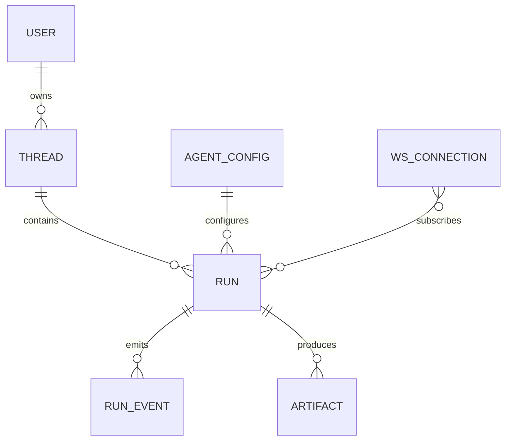
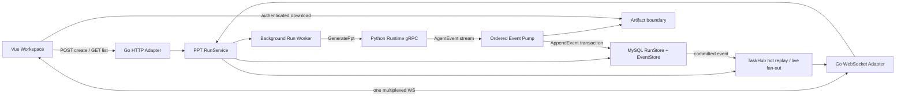
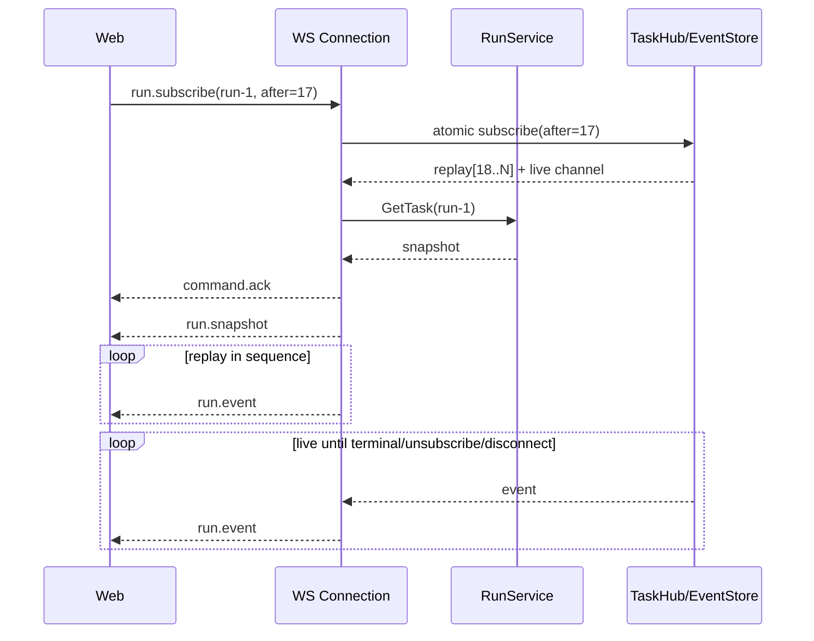
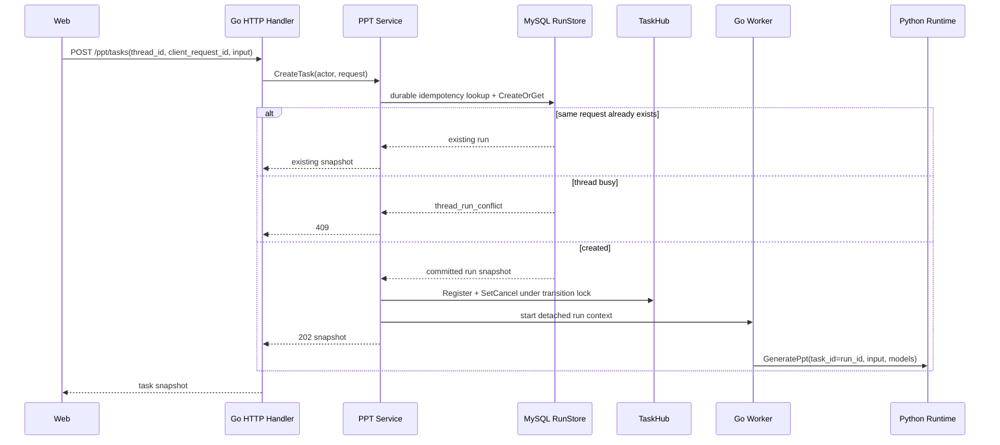
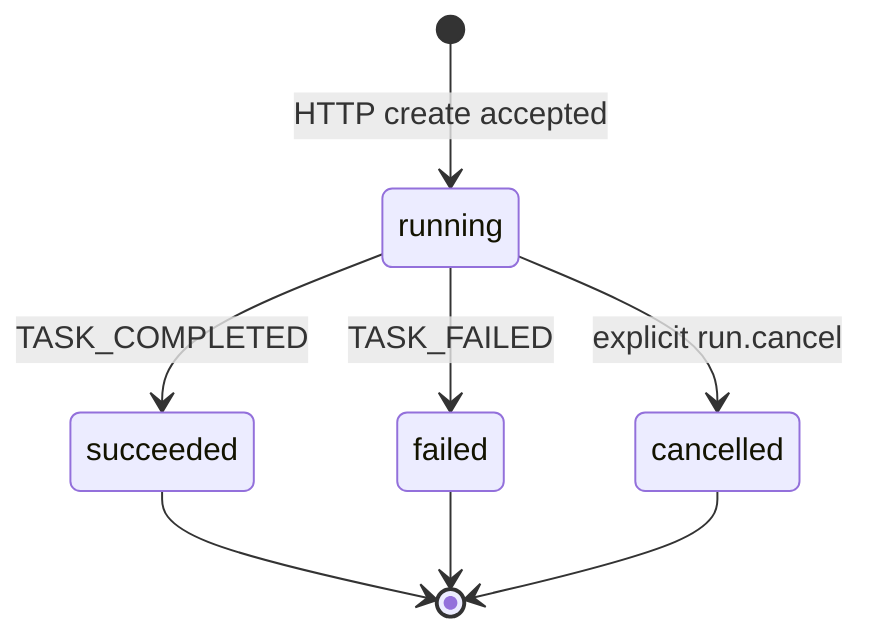
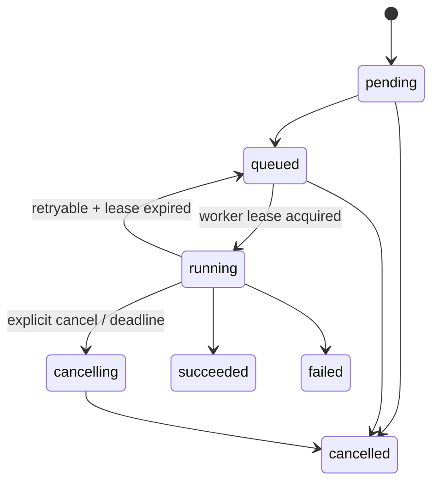
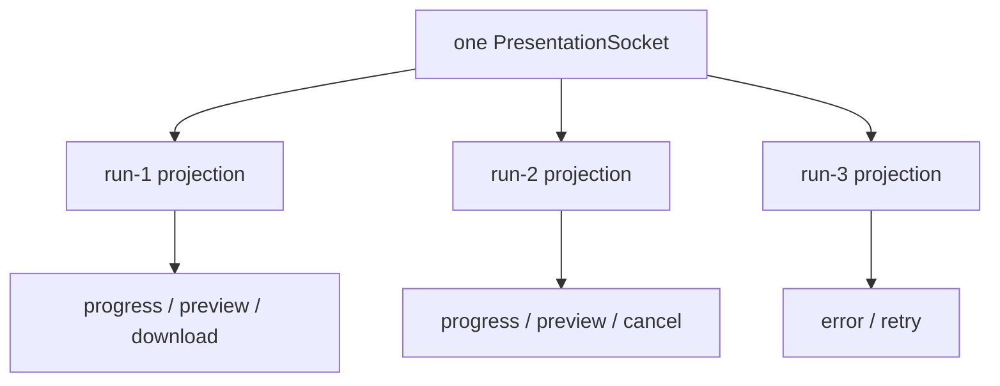

# PPT Agent WebSocket 流式链路设计

> 状态：Go-first 实现说明；WS、多 run 与 MySQL Run/Event 持久化已落地
> 核心决定：PPT 实时链路只使用 WebSocket，不提供 SSE 路由

> 当前 PPT transport、Run/Event 持久化和恢复契约以本文与 `docs/API.md` 为准；其他仍在整理的 Runtime 流水线文档若出现 SSE/仅内存描述，不代表现行 API 行为。
> 当前 HTTP 入口：`/api/v1/ppt/tasks`
> WebSocket 入口：`GET /api/v1/ppt/ws`
> 协议版本：`1`

## 1. 结论

本项目采用“HTTP 创建 + 单 WebSocket 多路复用”的链路：

1. 文本、参数和附件通过 `POST /api/v1/ppt/tasks` 创建后台 run；
2. 一个浏览器工作台只维护一条 `/api/v1/ppt/ws` 连接；
3. 这条连接可以同时订阅多个 run，并承载订阅、取消、心跳和服务端事件；
4. PPT 不提供 SSE event endpoint；前端不建立 EventSource 或 SSE reader；
5. `conv_id` 统一命名为 `thread_id`；第一阶段它只是 Go 侧的逻辑分组和同线程互斥键，不代表 Python 已有持久上下文；
6. 当前 `task_id` 等于 `run_id`，表示一次具体 PPT 执行；
7. 同一用户的同一个 thread 同时只允许一个 worker；取消后也要等旧 worker 退出才释放 thread，不同 thread 可并行；
8. socket 断开只取消订阅，不取消后台 run；客户端按每个 run 的 `sequence` 重连续传；
9. Go 的领域事件不依赖 WebSocket。WS 只是 MySQL Run/EventStore 之上的命令/事件 adapter，未来多实例升级不改变前端事件语义；
10. WS `run.cancel` 是前端主路径；连接不可用或 WS 命令失败时，前端使用 HTTP cancel fallback，两者调用同一 RunService；
11. 当前阶段实现“多个独立 run 同时各生成一个 PPT”。“一次 run 生成多个 PPT 变体”需要后续把单一 `ppt_file` 升级为 `outputs[]`，不与连接复用混为一件事。

一句话概括完整闭环：

```text
HTTP 创建 run
  -> Go 后台调用 Python gRPC server stream
  -> Go 规范化并保存 run event
  -> 单条 WS 按 run_id 多路复用推送
  -> 浏览器按 sequence 投影每个 run 的独立 UI
```

## 2. 为什么仍保留 HTTP 创建

“直接使用 WS”在这里指实时订阅、事件和主动取消使用 socket，并不意味着所有字节都必须塞入 socket。

创建 PPT 仍使用 HTTP 有三个原因：

- 当前接口已经支持 JSON 和 multipart 附件；
- 文件上传适合 HTTP 的体积限制、超时、审计和失败响应；
- run 必须先成为独立后台资源，不能依附一条可能随时断开的连接。

即使输入只是一句话，也继续走同一个 HTTP 创建接口，避免维护“纯文本走 WS、带附件走 HTTP”的两套幂等逻辑。创建成功后，实时状态和重连只走 WS；取消优先走 WS，HTTP 只是无实时连接时的命令 fallback。

未来若确实需要极低延迟的纯文本 `run.start`，可以在不改变 RunService 的前提下增加 WS command adapter；它仍必须先创建独立 run，再异步执行。

## 3. WebSocket 与 SSE 的关系

WebSocket 不是 SSE 的“超集”。两者只是不同 transport：

| 维度 | WebSocket | SSE |
| --- | --- | --- |
| 方向 | 全双工 | 服务端到客户端单向 |
| 命令 | 可在同一连接发送 | 通常另发 HTTP |
| 多 run 复用 | 由协议动态订阅 | 通常每个 stream 一条请求 |
| 重连 | 应用维护 cursor 和重订阅 | 仍需业务定义可恢复 cursor |
| 背压 | send queue、超时和断连策略 | HTTP writer 和断连策略 |
| 可靠性 | 依赖 EventStore、sequence 和幂等 | 同样依赖 EventStore、sequence 和幂等 |

本项目选择 WS，是因为工作台需要同时跟踪多个长任务、动态订阅/取消，以及后续可能出现审批和多模态控制。PPT API 只实现 WS 实时协议，不提供 `GET /api/v1/ppt/tasks/{run_id}/events`，也不存在并行的 SSE 实时入口。可靠性来自 run/event 模型，不来自 Upgrade 本身。

## 4. 参考项目带来的取舍

### 4.1 AILabs 链路中保留的思想

参考的 AILabs client-chat-model 链路有几项值得沿用：

- 一条 transport session 对应一个 WebSocket connection；
- `readPump` 是连接的唯一 reader，`writePump` 是唯一 writer；
- transport session 只管理连接、发送队列和退出，不承载模型业务；
- `convId` 标识持久对话，connection/session ID 只标识一次网络连接；
- 上行命令 ACK 只表示命令已被服务端接受，不表示模型执行完成；
- Model 的 server-stream 由业务层消费，再转换成面向客户端的类型化事件。

本项目不会照搬其中“把每条文本拆成 chunk assembler”的复杂度。PPT 输入目前是文本和文件，HTTP 已能可靠提交完整输入；WS 只需要管理 run command 和 event。

### 4.2 LangSmith Agent Server 中借鉴的概念

借鉴而不照搬：

- assistant/config、thread、run 三层资源；
- thread 是跨多个 run 的上下文容器；
- run 是后台执行资源，连接断开不应让资源消失；
- 同 thread 一次只执行一个 run，不同 thread 可以并行；
- run 状态、队列和事件应持久化；
- stream 可以按最后事件游标恢复；
- double-texting 必须明确选择 enqueue、reject、interrupt 或 rollback；
- 显式 cancel 与网络 disconnect 是两个不同动作。

LangSmith 的传统 stream 文档主要展示 SSE；其新事件协议也提供 WS command/event surface。本项目不追求 LangGraph API 兼容，只采用 thread/run、统一 envelope、cursor 和后台执行这些稳定思想，并按产品决定使用 WS 作为 Web 实时主链。

## 5. 标识体系

### 5.1 规范字段

| 字段 | 含义 | 生命周期/约束 |
| --- | --- | --- |
| `thread_id` | PPT 工作的逻辑分组键；对应参考项目 `conv_id` | 第一阶段只用于关联 run 和同线程 worker 互斥；无 checkpoint/历史上下文 |
| `run_id` | 一次 PPT 执行 | 当前兼容期 `task_id == run_id` |
| `task_id` | 旧 API 兼容字段 | 必须始终与 `run_id` 相等 |
| `client_request_id` | 创建命令的幂等键 | MySQL 中按 owner 唯一；跨 API 重启仍返回原 run |
| `request_id` | WS command 与响应的关联 ID | ACK/error 关联 command；订阅 snapshot/run.event 关联对应 subscribe；cancelled snapshot 关联 cancel command；服务端只对最近 4096 个 ID 去重 |
| `event_id` | 业务事件唯一 ID | MySQL 全局唯一，用于去重、日志和持久化 replay |
| `sequence` | 单个 run 内严格递增的事件序号 | 从 1 开始；重连续传 cursor |
| `connection_id` | 一次 WS 连接 | 断开即失效，不是业务主键 |
| `artifact_id` / `resource_id` | 不可变产物引用 | 必须绑定 owner 和 run |
| `attempt` | worker 重试或接管次数 | 生产持久化阶段加入，run 内递增 |

### 5.2 关系



WS connection 与 run 是多对多的瞬态关系。刷新页面会产生新 connection，但不会产生新 run。上图的 THREAD 是生产目标资源；第一阶段没有持久化 thread 表、checkpoint 或 Python 上下文恢复。

### 5.3 幂等创建

客户端每次提交生成请求都产生新的 `client_request_id`。服务端计算稳定请求指纹，覆盖：

- description；
- agent config；
- options；
- 附件名称、MIME、大小和 SHA-256。

规则：

- 相同用户、相同 `client_request_id`、相同指纹：返回已有 run，不重复启动 Python；
- 相同用户、相同 `client_request_id`、不同指纹：返回 `409 client_request_conflict`；
- 只有客户端在结果未知时主动复用原 ID，才能利用该幂等行为；用户主动“再生成一份”使用新 ID；
- TaskHub 重启或 terminal run 超出热缓存 retention 后，仍由 MySQL 唯一约束返回原 run；
- 未提供 `client_request_id` 的创建意图不做幂等合并，每次都会产生新 run。

## 6. 并发语义

必须区分两种“多个 PPT”：

### 6.1 多个 run 并行

这是当前阶段解决的问题：

```text
thread-A / run-1 -> PPT-A
thread-B / run-2 -> PPT-B
thread-C / run-3 -> PPT-C
```

它们共享一条 WS，各自拥有独立状态、sequence、预览、错误和下载链接。页面不能因为一个 run 正在执行就禁用整个输入框。

### 6.2 一个 run 产生多个 output

这是后续能力：

```text
thread-A / run-1
  -> 投资人版 PPT
  -> 销售版 PPT
  -> PDF
  -> 质量报告
```

当前 protobuf 和 `FinalResult.PPTFile` 只能表达一个主 PPTX。后续应引入：

```json
{
  "primary_output_id": "out-investor",
  "outputs": [
    {
      "output_id": "out-investor",
      "kind": "presentation",
      "status": "ready",
      "artifact_ids": ["art-pptx", "art-report"]
    }
  ]
}
```

不要通过重复 `TASK_COMPLETED` 或在 terminal 后继续补文件来模拟多 output。

### 6.3 同 thread 的 double-texting

第一阶段采用 `reject`：

- 同一个 owner + `thread_id` 已有 active worker 时，新创建返回 `409 thread_run_conflict`；
- 不同 thread 正常并行；
- 成功或普通失败后，worker 退出时释放 thread；
- 显式 cancel 先形成 terminal 快照和事件，但必须等旧 worker 真正退出才允许同 thread 的下一 run。

选择 reject 是为了让当前状态转换和 worker 互斥明确。MySQL 的 active-thread 唯一槽负责持久仲裁，TaskHub 保留当前进程 worker 退出屏障。`thread_id` 不会向 Python 恢复历史、checkpoint 或模型状态。后续可增加 `enqueue`，但必须由持久队列串行调度；`interrupt` 和 `rollback` 要等 checkpoint、副作用补偿与恢复语义成熟后再做。

## 7. 当前基线与目标边界

### 7.1 改造前

```text
Web 单一 task state
  -> POST /ppt/tasks
  -> Go goroutine
  -> Python gRPC stream
  -> Go TaskHub
  -> 每个 task 一条独立单向 stream
```

Go 本来就能启动多个 goroutine，TaskHub 也按 task ID 隔离；真正把产品限制成“只能生成一个”的主要是前端单例状态和单流 controller。

### 7.2 第一阶段代码能力

当前代码能力：

- MySQL `ppt_runs` 是 Run 快照、owner、幂等和同 thread worker guard 的事实源；
- MySQL `ppt_run_events` 连续保存全部 canonical `AgentEvent`，事件和快照同事务推进；
- TaskHub 只保留当前 Go 进程的 cancel func、热 replay 和 live fan-out，带有限 TTL；
- 创建后仍由 Go 启动后台 goroutine；
- Go 到 Python 仍使用现有 gRPC server stream，proto 仅传 `task_id=run_id`；
- 增加 thread/run/client request ID 和任务列表，但 thread 仅是 Go 逻辑分组；
- 同 thread active worker 由数据库唯一约束原子 reject，cancel 后等 worker 退出再释放；
- `client_request_id` 幂等跨请求和 API 重启有效；
- 增加一个多 run 复用的 WS adapter；
- 前端改为一条 WS 和 `runsById`；
- 删除 PPT SSE 路由，实时订阅只提供 WS；
- WS cancel 失败或连接不可用时，前端使用 HTTP cancel fallback；
- 一个 run 只产出一个主 PPTX。

这能解决同页并行、切换、取消、断线重订阅和终态历史查询。API 重启后可查询并重放已提交事件；由于 Python 没有 checkpoint，重启时尚在运行的任务会被收口为可重试失败，而不是续跑。当前仍不具备多 API 实例一致性。

### 7.3 第一阶段已知限制

以下能力尚未实现，不应在 API 文档、UI 或验收中当作当前保证：

- `thread_id` 没有持久化 thread 实体、Python checkpoint 或多轮模型上下文；
- access token、JWT blacklist 和 Redis session 只在 WS 握手时校验；已建立连接不会因 token 过期或另一端注销而主动断开；
- WS 自动重连尚不会主动刷新 access token；
- run 只有显式 cancel，没有服务端 deadline/超时终态；
- 没有 per-user run/connection quota，也没有 command/sec 和 subscribe/sec rate limit；
- 没有全局 WS connection registry，`http.Server.Shutdown` 不会主动管理已 hijack 的 socket；
- API 重启不能续跑 active Python 任务；启动恢复会追加 `TASK_FAILED/SERVER_RESTARTED`；
- `ppt_runs/ppt_run_events` 已持久化，但产物仍在本地/共享文件系统，尚未使用对象存储；
- 当前启动恢复策略只适用于单 API 实例，尚无 lease、fencing token、outbox 或跨实例 notifier；
- worker 在瞬时 DB 故障中退出时，当前进程会有限次后台重试失败终态；超过重试窗口仍依赖下次单实例启动恢复；
- 只支持单 run 单主 PPTX，不支持 `outputs[]`。

### 7.4 生产目标

生产级目标在现有 Run/Event 事实源之上继续扩展：

- MySQL：Run/Event 已落地；后续再增加独立 thread metadata、artifact catalog、lease 与 outbox；
- durable queue + lease：后台调度、重试、抢占保护和并发配额；
- Redis Streams/pubsub：只做跨实例通知或队列，不代替 run/event 持久化；
- transactional outbox：保证“创建 run”和“可被 worker 消费”不分裂；
- object storage：多主机场景的产物存储；
- EventStore replay：任意 API 实例都能按 cursor 恢复。
- run deadline、用户/全局并发配额和 command/subscription rate limit；
- WS connection registry 与 graceful shutdown；
- token 过期/注销断连、安全的 refresh/reconnect 和更合适的浏览器凭证。

文档后文同时标出第一阶段和生产阶段，避免把规划描述成已经实现。

## 8. 总体组件



领域层只认识 Task/Run、AgentEvent、Subscription、Cancel。它不认识 websocket connection、JSON frame 或 Vue component。

## 9. HTTP API

第一阶段继续使用现有 `/ppt` 命名。HTTP 只承载资源创建/查询、取消 fallback 和产物下载，不承载实时事件：

| 方法 | 路径 | 用途 |
| --- | --- | --- |
| `POST` | `/api/v1/ppt/tasks` | 创建 run；支持 JSON/multipart |
| `GET` | `/api/v1/ppt/tasks?thread_id=&limit=` | 恢复当前用户最近 run |
| `GET` | `/api/v1/ppt/tasks/{run_id}` | 获取权威 snapshot |
| `POST` | `/api/v1/ppt/tasks/{run_id}/cancel` | 前端在 WS 不可用或 `run.cancel` 失败时的 fallback |
| `GET` | `/api/v1/ppt/tasks/{run_id}/file` | 下载主 PPT |
| `GET` | `/api/v1/ppt/tasks/{run_id}/artifacts/{path}` | 鉴权预览/资源 |

实时入口另为 `GET /api/v1/ppt/ws`，该请求只用于 Upgrade 到 WS v1，不是 HTTP 实时事件接口。

创建请求新增：

```json
{
  "thread_id": "thread-uuid",
  "client_request_id": "request-uuid",
  "agent_config_id": 12,
  "description": "生成一份季度复盘 PPT",
  "options": {
    "language": "zh-CN",
    "expected_slide_count": 12,
    "aspect_ratio": "16:9"
  }
}
```

当前兼容规则：若旧客户端不传 `thread_id`，Go 自动生成一个，因此两个旧请求仍属于不同 thread，可以并行。

## 10. WebSocket v1

### 10.1 建连和鉴权

浏览器不能给原生 `WebSocket` 自定义 `Authorization` header。当前系统又使用 bearer access token，因此握手采用两个 subprotocol token：

```ts
new WebSocket(wsURL, [
  'agent-task-v1',
  `bearer.${accessToken}`,
])
```

服务端流程：

1. 只接受 `GET /api/v1/ppt/ws`；
2. 从请求的 subprotocol 列表中读取唯一 `bearer.<JWT>`；
3. 在 Upgrade 前复用现有 JWT、黑名单和 session 校验；
4. 将 actor/claims 放入 request context；
5. 由 Gorilla 默认同源策略校验 Origin；开发代理保留浏览器侧 Host，若未来允许跨域再引入显式 allowlist；
6. Upgrade 时只选择并回显公共协议 `agent-task-v1`；
7. 永远不把 bearer token 回显到 `Sec-WebSocket-Protocol` 响应头，也不放 query string；
8. 日志不得记录完整 subprotocol/token。

这是“握手时鉴权快照”：当前连接建立后不再检查 token 过期、blacklist 或 session 注销。既有 socket 因凭证变化而主动断开、重连前 refresh token，以及 Secure + HttpOnly + SameSite cookie/一次性短效 WS ticket，均是后续安全演进，不是第一阶段能力。

### 10.2 统一 envelope

所有文本帧使用同一个 envelope：

```json
{
  "schema_version": "1",
  "type": "run.subscribe",
  "request_id": "cmd-uuid",
  "created_at": "2026-07-20T10:00:00Z",
  "payload": {}
}
```

约束：

- `schema_version` 必须是字符串 `"1"`；
- `type` 必填；
- client command 必须有 `request_id`；服务端对每条连接最近 4096 个 ID 去重，不承诺连接全生命期无界去重；
- server 的 `command.ack`/`command.error` 原样回显 command request ID；
- subscribe 产生的 `run.snapshot` 和该 subscription 的 `run.event` 都带有 `run.subscribe.request_id`，用于关联替换前后的 subscription；
- `run.cancel` 直接返回的 cancelled `run.snapshot` 是例外：它回显 cancel command 的 request ID；
- 业务字段全部放 `payload`，不在顶层散落 run ID；
- 一个 frame 只包含一个 JSON object；
- v1 只允许 text frame；附件和产物不进 WS；
- 第一阶段服务端设置 read limit、90 秒 read/idle deadline、write deadline 和每连接最大订阅数；rate limit 尚未实现。

### 10.3 Client -> Server

订阅并从 cursor 后恢复：

```json
{
  "schema_version": "1",
  "type": "run.subscribe",
  "request_id": "cmd-1",
  "payload": {
    "run_id": "run-1",
    "after": 17
  }
}
```

取消订阅但不取消 run：

```json
{
  "schema_version": "1",
  "type": "run.unsubscribe",
  "request_id": "cmd-2",
  "payload": {"run_id": "run-1"}
}
```

显式取消后台 run：

```json
{
  "schema_version": "1",
  "type": "run.cancel",
  "request_id": "cmd-3",
  "payload": {"run_id": "run-1"}
}
```

应用层心跳：

```json
{
  "schema_version": "1",
  "type": "ping",
  "request_id": "cmd-4",
  "payload": {}
}
```

### 10.4 Server -> Client

连接可用：

```json
{
  "schema_version": "1",
  "type": "connection.ready",
  "created_at": "2026-07-20T10:00:00Z",
  "payload": {
    "connection_id": "conn-uuid",
    "schema_version": "1"
  }
}
```

浏览器的 native `onopen` 只表示 WebSocket 握手完成。前端必须等到 `connection.ready` 后，才能发送首次订阅、重连重订阅和应用层心跳。
当前前端为这一步设置 8 秒握手计时；socket 已 open 但迟迟没有 `connection.ready` 时，以应用 close code 关闭并进入退避重连，避免永久卡在 connecting。

命令成功：

```json
{
  "schema_version": "1",
  "type": "command.ack",
  "request_id": "cmd-1",
  "created_at": "2026-07-20T10:00:01Z",
  "payload": {
    "command": "run.subscribe",
    "run_id": "run-1"
  }
}
```

权威快照：

```json
{
  "schema_version": "1",
  "type": "run.snapshot",
  "request_id": "cmd-1",
  "created_at": "2026-07-20T10:00:01Z",
  "payload": {
    "thread_id": "thread-1",
    "run_id": "run-1",
    "task_id": "run-1",
    "status": "running",
    "last_event_sequence": 20
  }
}
```

业务事件：

```json
{
  "schema_version": "1",
  "type": "run.event",
  "request_id": "cmd-1",
  "created_at": "2026-07-20T10:00:02Z",
  "payload": {
    "schema_version": "1",
    "event_id": "event-uuid",
    "thread_id": "thread-1",
    "run_id": "run-1",
    "task_id": "run-1",
    "sequence": 21,
    "channel": "updates",
    "type": "STEP_PROGRESS",
    "stage": "GENERATING_PAGES",
    "message": "正在生成第 4 页",
    "progress": {"current": 4, "total": 10, "percent": 40, "unit": "slide"}
  }
}
```

命令失败：

```json
{
  "schema_version": "1",
  "type": "command.error",
  "request_id": "cmd-3",
  "created_at": "2026-07-20T10:00:03Z",
  "payload": {
    "command": "run.cancel",
    "code": "run_already_finished",
    "message": "PPT task is already finished",
    "retryable": false
  }
}
```

心跳响应使用 `pong`，回显 request ID。协议错误尽量发送 `command.error`；无法安全继续解析、超出 frame 限制或严重背压时直接用明确 close code 关闭连接。

### 10.5 订阅时序

`run.subscribe` 必须形成“snapshot + replay + live”且不能留下查询/订阅窗口：



当前活跃 run 由 TaskHub 在一个 mutex 临界区内复制热 replay 并注册 live channel；Hub 已淘汰的终态 run 则从 MySQL 按 `sequence > after` 读取完整事件并返回关闭的 live channel。因为数据库持久化全部 canonical event，两条路径都保持连续 cursor。未来多实例需要“读到 high watermark + notifier 唤醒 + 继续 ReadAfter”的算法。

snapshot 的 `last_event_sequence` 是服务端状态水位，不代表浏览器已经应用到该序号。浏览器只用实际收到并成功投影的 `run.event.sequence` 推进 cursor。

同理，terminal snapshot 只有在本地 cursor 已达到其 `last_event_sequence` 时，才足以结束期望订阅；若本地仍落后，客户端必须保留重订阅意图直到终态 event 被应用。这样即使在 snapshot 与 replay 之间断线，也不会永久丢失时间线和页面预览。

重复 subscribe 允许替换旧订阅。替换窗口可能收到重复事件，客户端必须按 `(run_id, sequence)` 去重。

`run.snapshot` 与该 subscription 的 replay/live `run.event` 都回显本次 subscribe 的 request ID。客户端替换订阅后，可用它识别上一个 subscription pump 的滞后 frame；业务去重仍以 `(run_id, sequence)` 为准。

如果 `after` 大于服务端的 `last_event_sequence`，服务端返回可重试的 `command.error(code=event_cursor_ahead)` 和当前水位，不注册 live subscription。客户端先以 `after=0` 重放并重建投影，不能把本地超前 cursor 直接当作服务端事实。

### 10.6 Cancel 的客户端可见顺序

WS 主路径接受 `run.cancel` 后，客户端可见顺序固定为：

```text
command.ack(request_id=cancel-command)
  -> run.snapshot(status=cancelled, request_id=cancel-command)
  -> run.event(TASK_FAILED + TASK_CANCELLED, request_id=subscribe-command)  # 仅当该 run 已订阅
```

ACK 表示取消状态转换已由 RunService 原子接受。ACK 和 cancelled snapshot 都回显 cancel command ID；若当前已订阅该 run，随后由 subscription pump 推送的 terminal event 回显原 subscribe command ID。如果当前未订阅该 run，连接只收到 ACK 和 snapshot。HTTP cancel fallback 调用同一 RunService，HTTP 响应返回 cancelled snapshot；若仍有 WS subscription，terminal event 仍由它推送。

### 10.7 terminal 与连接

- terminal 是 `TASK_COMPLETED` 或 `TASK_FAILED`；取消投影为 `TASK_FAILED + TASK_CANCELLED`；
- terminal 结束该 run 的 subscription；
- terminal 绝不关闭整条 WS，因为同一连接还可能订阅其他 run；
- terminal 必须是 run 的最后一条业务事件；
- 连接断开默认不取消任何 run；
- 只有明确收到并接受 `run.cancel` 才取消后台 context。

## 11. Go 侧链路

### 11.1 Router 与鉴权

WS 路由需要在普通 protected group 外注册，因为浏览器握手没有 Authorization header：

```text
/api/v1/ppt/ws
  -> Versioned response marker
  -> WS bearer subprotocol extractor
  -> existing Auth middleware
  -> Handler.WebSocket
```

extractor 只负责严格解析 bearer subprotocol 并临时写入内部 Authorization header；JWT、blacklist、Redis session 校验仍只有一份实现。

### 11.2 Connection 对象

建议职责：

```go
type wsSession struct {
    id            string
    actor         actor.User
    conn          *websocket.Conn
    send          chan ServerEnvelope
    done          chan struct{}
    subscriptions map[string]context.CancelFunc
}
```

每条连接：

- 一个 reader goroutine；
- 一个 writer goroutine；
- 每个 run 最多一个 subscription pump；
- 所有业务 goroutine只写有界 `send` channel，绝不直接调用 `WriteJSON`；
- reader 退出、writer 错误或严重背压统一 cancel connection context；
- cleanup 只关闭 subscription，不调用 RunService.Cancel。

第一阶段没有全局 connection registry，因此 server shutdown 不在上述已实现触发条件内。生产阶段需要注册所有 hijacked connection，在 drain 时显式发 close frame 并取消 connection context。

### 11.3 单 writer

AILabs 的关键经验在这里直接适用：Gorilla connection 不能让多个 goroutine并发写。所有 ACK、snapshot、event、pong 和 close control 都由唯一 writer 串行发送。

写路径：

```text
command handler / subscription pump
  -> bounded send queue
  -> single writer
  -> SetWriteDeadline
  -> WriteJSON
```

队列满时不能静默丢 lifecycle、artifact、error 或 terminal。第一阶段直接关闭慢连接，让客户端从最后已应用 sequence 重连。run worker 不被慢浏览器阻塞。

### 11.4 Reader 与命令分发

reader 的处理顺序：

1. 读取 text frame；
2. 校验 frame size；
3. JSON decode，拒绝未知字段和多个顶层 JSON 值；
4. 校验 schema version、type、request ID 和 payload；
5. 查找 command handler；
6. 以连接中的 owner 调用 Service；
7. 把 ack/error 放入 send queue。

无论客户端传什么 owner/thread 字段，服务端最终都按 Auth actor 查询 run。越权与不存在统一暴露 `run_not_found`，避免枚举他人任务。

### 11.5 Run 创建



后台 context 不能直接使用请求的 cancellable context，否则 HTTP response 完成就可能取消任务。第一阶段使用保留 request values 的 detached context，并只支持显式 cancel；尚未实现 run deadline。生产阶段再交给带 deadline、lease 和重试语义的 supervisor/queue worker。

持久 row 从提交到本地 cancel function 安装完成始终持有同一个 run transition lock；并发 cancel 会等待初始化结束。`run_not_ready` 仍作为可重试的防御性错误码保留，但不应成为正常创建路径的可见状态。

Go 内部 `RuntimeRequest` 已同时保留 `thread_id` 与 `run_id`。当前 Python gRPC proto 仍只有 `task_id`，所以适配层先以 `task_id=run_id` 调用 Runtime；Run/Event 落库不等于 Python checkpoint，`thread_id` 的上下文传递和中断续跑属于后续 checkpoint 阶段。当前 Python Runtime 不读取 thread history 或 checkpoint。

### 11.6 Runtime 事件 pump

Python gRPC stream 的唯一 `Recv()` goroutine也是排序点：

```go
for {
    event, err := stream.Recv()
    if err != nil {
        publishFailureIfOpen(err)
        return
    }
    normalizeIDs(event, threadID, runID)
    validateSequenceAndPayload(event)
    if event.Type == ARTIFACT_READY || event.Type == TASK_COMPLETED {
        verifyReportedArtifacts(event)
    }
    next, canonical, err := runStore.AppendEvent(event) // Event + snapshot transaction
    if err != nil {
        if errors.Is(err, ErrEventCommitUnknown) {
            hub.Invalidate(runID) // close subscribers and cancel ambiguous worker
        }
        publishRetryablePersistenceFailureIfPossible(err)
        return
    }
    if err := hub.PublishCommitted(next, canonical); err != nil {
        hub.Invalidate(runID) // close subscribers and cancel divergent worker
        return
    }
    if event.Terminal() {
        return
    }
}
```

不变量：

- 第一条事件只能 start 或 fail；
- `sequence == previous + 1`；
- event 的 thread/run/task ID 必须一致；
- Go 补齐 schema version、event ID、channel 和 timestamp；
- terminal exactly once，terminal 后拒绝任何事件；
- gRPC EOF 没有 terminal 时，Go 合成失败终态；
- provider/API key 等 secret 不能进入 event、Task 或日志；
- 最终 PPTX 必须在下载使用的 artifact root 中存在、是非空普通文件，并匹配 Runtime 提供的 size/hash，之后才能提交成功 terminal。

### 11.7 取消

`run.cancel` 的目标是 run，不是 subscription：

```text
WS reader
  -> RunService.CancelTask(owner, run_id)
  -> MySQL 同一事务写 cancelled terminal event + Run snapshot
  -> DB commit 后 TaskHub 广播，并触发 run cancel func
  -> WS writer: command.ack
  -> WS writer: run.snapshot(cancelled)
  -> subscription pump: terminal event（若已订阅）
  -> gRPC context 观察到 cancelled，worker 退出
  -> 释放同 thread worker 互斥
```

cancel 与 complete 可能竞态。RunStore 通过行锁、sequence CAS 和 terminal 状态原子决定唯一赢家；输掉的一方收到 already finished，而不是再写第二个 terminal。terminal 可以先对客户端可见，但数据库 `worker_active` 与本地 Hub 互斥必须保留到 worker 真正退出，防止取消中的旧 Runtime 与新 run 重叠。

## 12. 领域事件

第一阶段沿用现有 AgentEvent，补齐稳定 envelope：

```go
type AgentEvent struct {
    SchemaVersion string
    EventID       string
    ThreadID      string
    RunID         string
    TaskID        string // run_id alias
    Sequence      uint64
    CreatedAt     time.Time
    Channel       EventChannel
    Type          EventType
    Stage         Stage
    Message       string
    Progress      *Progress
    Resources     []ResourceRef
    Page          *PageDetail
    Error         *ErrorDetail
    FinalResult   *FinalResult
}
```

channel 当前分三类：

| Channel | 事件 | 是否可丢 |
| --- | --- | --- |
| `lifecycle` | started/completed/failed | 不可丢 |
| `updates` | step started/progress/completed | 用户可见进度不可静默丢；未来高频值可合并 |
| `artifacts` | preview/PPT/resource ready | 不可丢 |

前端只依赖公开 stage/event，不应绑定 Python graph 节点名。以后增加 token、审批或 usage 时扩展 channel/type，而不是改变 WS frame 外形。

## 13. 状态机

第一阶段状态：



生产阶段增加队列和 attempt：



前端必须把 terminal 看作每个 run 的属性，而不是整个 workspace 的属性。

## 14. 重连、顺序和去重

客户端为每个 run 独立保存：

```ts
interface RunViewState {
  snapshot: PptTask
  lastEventSequence: number
  events: PptTaskEvent[]
  previewURLs: string[]
  error?: string
}
```

断线恢复算法：

1. socket close；所有 run 仍留在 `runsById`；
2. 指数退避并带 jitter 重连，设置最大单次延迟；
3. native `onopen` 后仍保持协议未就绪；只有收到 `connection.ready` 后，才对每个需跟踪的 run 发送 subscribe；ready 超时则关闭并重连；
4. `after` 使用该 run 最后成功投影的 sequence；
5. 收到 event 时先校验 run ID；
6. `sequence <= cursor` 视为重复并忽略；
7. `sequence == cursor + 1` 才应用并推进 cursor；
8. `sequence > cursor + 1` 表示缺口，重新 subscribe 或 GET snapshot + replay，不能直接跳过；
9. terminal 后保留历史和下载，不再自动订阅 live；
10. 页面刷新先 `GET /ppt/tasks` 恢复 snapshot，再建立 WS 并按 cursor 订阅。

TaskHub 负责当前进程的低延迟 replay/live，MySQL 负责 Hub 淘汰和 API 重启后的连续历史 replay。这里的 durable 指 Run 快照和事件历史；尚在执行的 Python 任务没有 checkpoint，API 重启后会变为 `SERVER_RESTARTED` 失败，不能从中间阶段续跑。当前 WS 重连也只读取现有 access token，不负责 refresh；安全的 token refresh/reconnect 编排属于后续能力。

## 15. 背压和容量

### 15.1 Connection 级别

第一阶段已实现：

- 每连接最大订阅 run 数；
- frame read limit、90 秒 read/idle deadline、有界 send queue 和 writer deadline；
- queue 满或写超时关闭连接，客户端用 cursor 恢复；
- 应用层 `ping/pong`，不占 run sequence。

未实现，归入生产容量与安全演进：

- 每用户并发 run 数和 WS connection 数配额；
- commands/sec 和 subscribe/sec rate limit；
- 跨连接、跨实例的容量调度。

### 15.2 Producer 级别

runtime 事件先提交 MySQL EventStore，再进入 Hub live fan-out，不可先向客户端声明成功。Hub subscriber 溢出时，WS adapter 必须关闭整条慢连接，让客户端从已应用 cursor 重连并从 MySQL 补发；不能只静默结束单 run subscription。

### 15.3 建议指标

```text
ws_connections_active
ws_commands_total{type,result}
ws_subscriptions_active
ws_reconnects_total
ws_send_queue_full_total
ws_write_duration_seconds
run_active_total
run_duration_seconds{status}
run_events_total{type,channel}
run_replay_events_total
run_cancel_latency_seconds
```

日志关联字段至少包含：

```text
request_id, connection_id, owner_id, thread_id, run_id, event_id, sequence, stage
```

## 16. 安全边界

- 所有 get/list/subscribe/cancel/download 都按 authenticated owner 过滤；
- 不信任 client frame 中的 owner/user ID；
- run 不存在和不属于当前用户统一返回 not found；
- subprotocol bearer 仅用于握手鉴权，不写日志、错误或 metrics label；
- 使用 Gorilla 默认同源检查；反向代理必须保留可与浏览器 Origin 对齐的 Host，生产环境不使用 `CheckOrigin: true`；
- 第一阶段设置 HTTP header read timeout、WS read limit、90 秒 read/idle timeout 和 write deadline；
- JSON decoder拒绝未知 command 和非法字段；
- artifact path 继续做 canonical path 和目录边界校验；
- 当前 PPT Runtime 只发布 PNG preview；协议保留的 HTML/SVG 产物仍必须使用 CSP、sandbox 和 `nosniff`；
- provider credentials 只在 Go 调 Python 前解析，永远不进入 Task/Event；
- 异常错误对用户返回稳定 code/message，debug detail 只写脱敏日志；
- 当前 token/session 只是握手快照；连接存续期间的 token 过期、blacklist 和 session 注销不会主动终止 socket；
- 未来多实例场景禁止使用 connection ID 作为 Redis channel 或业务幂等键。

## 17. 持久化现状与后续演进

当前已经落地 `ppt_runs + ppt_run_events`，TaskHub 不再是历史事实源。后续生产演进如下：

| 表/组件 | 核心字段/职责 |
| --- | --- |
| `ppt_runs`（已实现） | thread、owner、请求指纹、状态快照、worker guard、heartbeat、结果/错误 |
| `ppt_run_events`（已实现） | durable event ID、run sequence、type/channel/完整 canonical payload、created_at |
| `agent_threads`（后续） | 只有 thread 需要标题、共享上下文或多轮 metadata 时再独立建表 |
| `agent_artifacts`（后续） | run/output、对象存储 key、MIME、size、hash、state |
| `run_queue` 或 run status queue | pending、priority、available_at、lease owner/expiry |
| transactional outbox | DB commit 后可靠唤醒 worker/notifier |

当前已实现的关键约束：

- unique `(owner_id, client_request_id)`、`(run_id, sequence)` 和 event ID 已实现；
- terminal event 与 run terminal status 同事务已实现；
- `worker_active` 生成列唯一槽确保同 owner/thread 单 active worker 已实现；
- Redis 只做信号/队列，权威状态从数据库读；

后续多实例目标（当前未实现）：

- attempt 使用 lease token，旧 worker 失去 lease 后不能继续 append；
- 任意 WS adapter 都能从 EventStore `ReadAfter`，通知丢失也能在下一轮补齐；
- 引入事件 retention 后，cursor 过期明确返回 `event_cursor_expired` 和 snapshot，不静默跳到最新。

## 18. 前端最后修改的原则

Go 的 ID、状态、错误码和 WS frame 固定后，再改 Vue：

1. `PresentationApi` 保留 create/list/get/cancel fallback/download；
2. 新增 workspace 级 `PresentationSocket`；
3. 一个 socket 管理 pending command、subscriptions 和 reconnect；native `onopen` 后等待 `connection.ready`，再发送订阅和心跳；
4. 单例 `task/events/streamController` 改为 `runsById`；
5. 每个 run 独立 cursor、投影、预览、错误和 cancel 状态；
6. composer 不因任一 run running 而整体 disabled；
7. 新建独立 PPT 默认生成新 thread ID，以允许并行；
8. 若是同一 PPT 的后续编辑，复用 thread ID，但必须等待当前 run terminal；
9. 取消优先发送 WS `run.cancel`；连接不可用或命令失败时，当前前端调用 HTTP cancel fallback；
10. 组件 unmount 关闭 socket 只会取消订阅，不会取消后台任务；
11. Vite `/api` proxy 必须启用 `ws: true` 并保留浏览器侧 Host（本项目设为 `changeOrigin: false`），否则 Gorilla 默认同源检查会把开发代理误判为跨域；
12. token 只通过 subprotocol 注入，不放 URL；自动 token refresh/reconnect 属于后续能力。



## 19. 分阶段落地

### 阶段 A：领域语义和 Go 单实例执行（已完成）

- 增加 thread/run/client request/event ID；
- `task_id == run_id` 兼容；
- MySQL 持久幂等、同 thread active worker reject，TaskHub 只保留热状态；
- GET task list；
- 后台 context 不依赖 HTTP request disconnect；
- 现有 gRPC adapter 以 `task_id=run_id` 调用 Python，`thread_id` 只留在 Go；
- cancel 后等 worker 退出再释放 thread；
- 明确无 Python checkpoint/历史恢复；
- 单元测试状态、顺序、越权、取消和竞态。

### 阶段 B：WS adapter（已完成）

- subprotocol 鉴权；
- v1 envelope；
- 单 reader/单 writer；
- subscribe/unsubscribe/cancel/ping；
- snapshot + replay + live；
- multiplex、terminal 不关 socket；
- 背压关闭和按 cursor 重连；
- subscribe snapshot/run.event 回显 subscribe request ID，cancelled snapshot 回显 cancel request ID，最近 4096 个 command request ID 去重；
- 完全删除 PPT SSE 路由，实时链路只保留 WS。

### 阶段 C：前端多 run（已完成）

- 单 socket manager；
- `runsById` 和任务切换器；
- 并行创建；
- list 恢复；
- 每 run 独立 cancel/preview/download/error；
- 收到 `connection.ready` 后再首次订阅/重连重订阅；
- 重连重订阅与 sequence 去重；
- WS cancel 主路径与 HTTP cancel fallback。

### 阶段 D：持久化和队列（Run/Event 已完成）

- 已完成 MySQL Run snapshot、完整 EventStore、durable idempotency 和 active-thread worker guard；
- 已完成终态历史查询/下载授权、Hub 淘汰后的 cursor replay，以及单实例重启时把遗留 active run 收口为 `SERVER_RESTARTED`；
- 待完成 durable queue、lease、fencing token、attempt 和 supervisor；
- 待完成 outbox/notifier 与多 API/worker 实例；
- 待完成可续跑的 Python checkpoint；
- enqueue 策略和用户/全局并发配额；
- run deadline、connection/run quota 和 command/subscription rate limit；
- WS shutdown registry 与 graceful drain；
- token/session 变更主动断连与 refresh-aware reconnect。

### 阶段 E：多 output 与多轮编辑

- `outputs[]` / artifact version；
- 一次 run 多 PPT variant；
- checkpoint、HITL、interrupt/resume；
- object storage；
- 评估是否增加纯 WS `run.start` 或二进制媒体 channel。

## 20. 测试矩阵

### 20.1 Run/Hub

| 用例 | 验收 |
| --- | --- |
| 相同 idempotency + 相同输入 | 跨请求/API 重启返回同一 run，runtime 只调用一次 |
| 相同 idempotency + 不同输入 | 409 conflict |
| 同 thread 两次 active create | 第二次 reject，未创建幽灵 run |
| cancel 后立即重建同 thread | 旧 worker 退出前仍 reject，不与新 Runtime 重叠 |
| 不同 thread create | 两个 runtime 可并行 |
| sequence 重复/跳号 | 拒绝且不推进 snapshot |
| EOF 无 terminal | 唯一 failed terminal |
| cancel/complete 竞态 | 只有一个 terminal |
| HTTP request 结束 | 后台 run 继续且保留 actor/trace values |
| list | 只返回 owner 数据，按时间倒序并限制 limit |

### 20.2 WS 协议

| 用例 | 验收 |
| --- | --- |
| 缺少/重复/非法 bearer subprotocol | Upgrade 前 401/400 |
| 正确握手 | response 只回显 `agent-task-v1` |
| subscribe after=N | 先 ack/snapshot，再无缺口 replay/live |
| 两个 run multiplex | 事件不会串 run，任一 terminal 不关 socket |
| 重复 subscribe | 替换旧 pump；重复事件可按 sequence 去重 |
| unsubscribe | 只停订阅，run 继续 |
| cancel | owner 校验；客户端可见顺序为 ACK→cancelled snapshot→terminal（若订阅） |
| socket disconnect | 所有 subscription 清理，run 不取消 |
| malformed/oversize frame | 明确 error/close，无 panic |
| slow writer/send queue full | 连接关闭，worker 不阻塞 |
| Hub subscriber overflow | 不静默结束单订阅；关闭 WS 并按 cursor 恢复 |
| request ID window | subscribe snapshot/event 关联 subscribe，cancel snapshot 关联 cancel；最近 4096 个 command ID 拒绝重复 |
| terminal task late subscribe | snapshot + replay 后 socket 仍可订阅其他 run |
| race test | 无并发 map/write 和 goroutine leak |

### 20.3 前端

| 用例 | 验收 |
| --- | --- |
| 两次快速提交 | 产生两个 thread/run，输入框保持可用 |
| 一条 socket | 多 run subscribe，不创建第二种实时 transport |
| WS 建连 | native onopen 不发命令；收到 `connection.ready` 后才订阅 |
| 乱序/重复 frame | 不回退状态，不重复预览 |
| 断线重连 | 每个 run 使用自己的 cursor 重订阅 |
| terminal | 仅该 run 停止 live，其他 run 继续 |
| 刷新 | list + get/subscribe 恢复任务列表 |
| cancel | WS command 主路径和 HTTP fallback 都正确反映在对应 run |
| token | 不出现在 URL、日志或 UI error |
| Vite/dev proxy | Upgrade 正常透传 |

### 20.4 当前单实例持久化

| 用例 | 验收 |
| --- | --- |
| Go 在 running 时重启（当前单实例） | 追加唯一 `SERVER_RESTARTED` terminal，释放 worker guard；历史可 replay |
| Hub TTL 淘汰/Go 重启后订阅终态 | MySQL 按 cursor 返回连续完整事件，不发生 1013 循环 |
| 相同 client request 重启后重试 | 返回原 run，不启动第二 worker |
| DB append 失败 | 不向 WS 声称事件已交付 |
| artifact 缺失/hash 错误 | 不发 ready/success terminal |

多实例的“API A 产流、API B 订阅”、notifier 丢失补齐和 lease 过期 fencing 属于后续生产验收，不是当前实现保证。

## 21. 验收定义

第一阶段完成的可观察结果：

1. 用户连续提交三份 PPT，页面出现三个独立 run；
2. 三个 run 使用三个 thread，可在 Go/Python 并发能力范围内同时执行；
3. 浏览器始终只有一条 PPT WebSocket；
4. 任一 run 失败、成功或取消不影响其他 run；
5. 断开网络后任务继续，恢复后从该 run 的最后 sequence 补发；
6. PPT API 不存在 SSE event route，前端实时事件只通过 WS；
7. 同 thread 重复提交会收到明确 conflict；cancel 后也要等旧 worker 退出才释放 thread；
8. 同一创建请求跨 HTTP 重试和 API 重启不会重复生成；不同请求复用同一幂等键返回明确 conflict；
9. 所有 subscribe/cancel/download 均验证 owner，HTTP cancel 仅作 WS fallback；
10. `thread_id` 仅是 Go 分组/互斥键，Python 仅接收 `task_id=run_id`，无 checkpoint；
11. 文档和 UI 明确说明：当前 run 仍只产出一个主 PPT，多 variant 属于下一阶段。

剩余生产级验收还必须包含多实例、durable queue、lease/fencing、跨实例 notifier、对象存储、可续跑 checkpoint、run deadline、用户配额/rate limit、WS shutdown registry，以及 token 过期/注销断连和 refresh-aware reconnect。Run/Event 已落库不等于这些能力自动具备。

## 22. 设计依据

外部参考：

- [LangSmith Agent Server](https://docs.langchain.com/langsmith/agent-server)：assistant/thread/run、持久化、任务队列和 API/worker 生命周期；
- [Use threads](https://docs.langchain.com/langsmith/use-threads)：thread 是跨多个 run 的持久上下文；
- [Streaming API](https://docs.langchain.com/langsmith/streaming)：多 stream mode、thread stream 和 cursor 恢复；
- [Double texting](https://docs.langchain.com/langsmith/double-texting)：enqueue、reject、interrupt、rollback；
- [Cancel a run](https://docs.langchain.com/langsmith/cancel-run)：显式取消与断线策略；
- [Protocol v2 command](https://docs.langchain.com/langsmith/agent-server-api/streaming/protocol-v2-command)：统一 command envelope 和 WS 内订阅命令。

本地参考：

- `/Users/cxf/Documents/Obsidian Vault/后端/AILabs/完整流式链路.md`：transport session、read/write pump、assembler、队列和 Model server-stream 闭环；
- `/Users/cxf/Desktop/AILabs/AILabs-Server/`：client-chat-model 的 `conv_id`、session 和 WebSocket 实现；
- `docs/PPT_GENERATION_PIPELINE.md`：本项目当前 PPT 链路；
- `contracts/proto/ppt/ppt_agent.proto`：当前单 PPT server-stream contract；
- `apps/api/internal/modules/pptagent/`：TaskHub、Service、Handler、artifact 和事件校验；
- `apps/web/src/features/presentations/`：当前前端任务投影和工作台。

最终边界是：Run snapshot、幂等与完整 canonical event 已是 MySQL 持久事实；TaskHub 是可丢弃的单进程热层，WebSocket connection 是可替换的实时通道。`thread_id` 当前仍只是持久化在 Run 上的分组/worker 互斥键，不代表 Python checkpoint 或多轮上下文。独立 thread metadata、可续跑 checkpoint、多实例 worker/lease、对象存储、完整凭证生命周期和多 output 仍属于后续演进。
