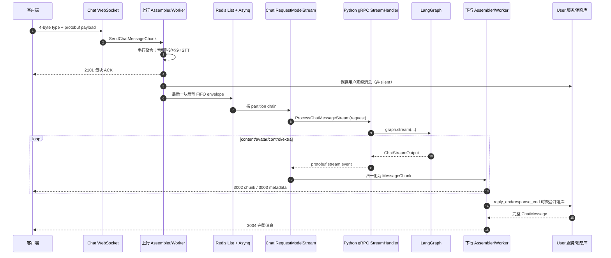
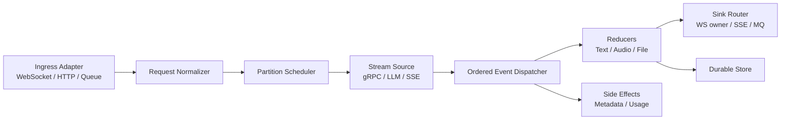

# 流式输出实现与复用指南

> 分析基线：`master` / `1a9764d`，2026-07-13。  
> 范围：客户端 WebSocket 上行、Chat 服务消息装配、Chat → Model 的 Python gRPC 服务端流、Model/LangGraph 产流、Chat → 客户端下行，以及 Bot 的另一条消费路径。  
> 本文描述的是当前代码的实际行为；“建议方案”章节才是面向其他项目的推荐实现。

## 1. 结论先行

这个项目已经形成了一套可借鉴的流式处理骨架，但不建议原样复制。

值得复用的核心设计有四点：

1. **内部生成协议与传输协议分层**：Python 用 `ChatStreamInput / ChatStreamOutput` 表达业务流，再由 handler 映射成 protobuf，而不是让 LangGraph 节点直接依赖 gRPC。
2. **单请求、多事件轨道**：Model 的响应不是只有文本 token，而是 `content / avatar / control / extra` 四条轨，能同时表达文本、图片、视频、动作、生命周期、错误和计费。
3. **Go 侧 `Assembler + Worker + Callback`**：接收层只负责把事件归一化成 `MessageChunk`，文本拼接、TTS、文件消息、持久化和客户端推送由不同 worker 处理。
4. **传输和最终消息分离**：客户端先收到 `CHAT_MESSAGE_CHUNK_PUSH` 增量，服务端完成聚合和落库后，再收到 `CHAT_MESSAGE_PUSH` 完整消息。

当前实现中，以下部分应先改造再借用：

- Chat 调 Model 使用 `context.Background()`，客户端断开、任务取消和超时不能沿链路传播。
- Model 的 `response_end` 在 postprocessor 和 usage 之前发出，少数 fallback 内容甚至可能在 `response_end` 之后出现。
- WebSocket、Assembler 和 gRPC 之间没有统一的背压策略：WebSocket 写队列会阻塞，Assembler 队列满时却直接拒绝新块，调用方只记录日志，因此可能丢 token。
- Model 的业务错误只在 Go 侧记日志，不回传客户端；gRPC 传输错误又不会补终止帧，客户端可能一直等待。
- 多实例 Chat 下，Asynq 任务不保证由持有 WebSocket 会话的实例消费，当前 Redis 客户端 channel 只实现了 kick，没有转发聊天流。
- Python 同步 gRPC 服务只有 10 个 worker；每条长流会长期占用一个线程。
- Bot 路径创建的 Assembler 没有 Stop/GC，会留下 goroutine。

因此，更准确的判断是：**可以借用协议分轨、DTO 映射、Assembler/Worker 思路；不要直接复制当前的生命周期、取消、背压和集群路由实现。**

## 2. 全链路总览

实时聊天不经过 Gate。客户端直接连接 Chat WebSocket（默认 7033），Chat 再调用 Python Model 的 gRPC（默认 7041）。Gate 只处理普通请求/响应 API。



分层职责如下：

| 层 | 当前技术 | 主要职责 | 是否直接流式 |
| --- | --- | --- | --- |
| 客户端 ↔ Chat | WebSocket + 自定义帧 + protobuf/可配置 codec | 双向消息块、ACK、服务端 push | 是 |
| Chat 入站装配 | `Assembler + UpstreamWorker` | 排序、聚合、STT、保存用户消息 | 是 |
| Chat 内部排队 | Redis List + Asynq | 去重、按会话 partition FIFO、异步解耦 | 消费时逐条，不是 token 流 |
| Chat → Model | gRPC unary-server-stream | 一次请求，多个响应事件 | 是 |
| Model 内核 | LangGraph `stream_mode` | LLM token、工具事件、状态更新、usage | 是 |
| Chat 出站装配 | `Assembler + DownstreamWorker` | 文本聚合、TTS、文件、持久化 | 是 |
| Chat → 客户端 | WebSocket server push | token、音频块、媒体、元数据、终止标记 | 是 |

## 3. 两层协议

### 3.1 Chat → Model：gRPC 服务端流

定义位于 `api/proto/v1/model/model.proto:17-19`：

```proto
rpc ProcessChatMessageStream(ProcessChatMessageRequest)
    returns (stream ProcessChatMessageStreamResponse) {}
```

这是 **unary request + server stream response**：Go 只发送一个完整请求，Python 连续返回 N 个事件。生成的 Go 客户端在 `api/go/v1/model/model_grpc.pb.go:76-89` 中自动完成：

1. `NewStream`；
2. `SendMsg(in)`；
3. `CloseSend()`；
4. 返回带 `Recv()` 的 `ServerStreamingClient`。

请求体在 `model.proto:70-127`，主要字段是：

| 字段 | 含义 |
| --- | --- |
| `user_id / conv_id` | 数据隔离和对话标识 |
| `sender / receiver` | 用户与 Soulmate 参与者 |
| `chat_message` | text/audio/image `oneof`，附带 proactive type |
| `reply_spec.msg_id` | 本次 AI 回复的 `chunk_msg_id` |
| `reply_spec.synthesize_voice` | 是否要求语音回复 |
| `scene` | 时区、位置、可用房间 |
| `settings` | Web 搜索、workflow、LLM 等 |

响应体在 `model.proto:130-237`，顶层是四轨 `oneof event`：

| 事件轨 | payload | Go 侧用途 |
| --- | --- | --- |
| `content` | `text_chunk / image / video / web_search` | 生成用户可见内容；文本进入主 Assembler，媒体进入独立文件 Assembler，引用成为最终消息 annotation |
| `avatar` | `action / routine` | 直接转成客户端 3D/状态元数据，不落聊天正文 |
| `control` | `lifecycle / error` | `reply_end` 分段、`response_end` 终止，或业务错误 |
| `extra` | `usage` | LLM 成本记录，不推给客户端 |

`reply_end` 与 `response_end` 不等价：

- `reply_end`：本次流中的一段回复结束，可以先聚合、落库为一条消息，流仍可继续。
- `response_end`：整个用户可见响应结束，触发下行 Assembler 的 `Finalize`。
- gRPC `io.EOF`：传输流自然结束。当前 Go 代码在未见 `response_end` 时会自行补一个终止 chunk。

### 3.2 Chat ↔ 客户端：WebSocket 消息协议

消息类型定义在 `api/proto/v1/chat/chat_conversation.proto:10-45`：

| 方向 | MessageType | 数值 | 作用 |
| --- | --- | ---: | --- |
| 客户端 → Chat | `SEND_CHAT_MESSAGE_CHUNK_REQUEST` | 1101 | 上传文本/音频/图片块 |
| Chat → 客户端 | `SEND_CHAT_MESSAGE_CHUNK_RESPONSE` | 2101 | 对每个上行块 ACK |
| Chat → 客户端 | `CHAT_MESSAGE_CHUNK_PUSH` | 3002 | AI 或 STT/TTS 的流式块 |
| Chat → 客户端 | `CHAT_MESSAGE_METADATA_PUSH` | 3003 | action/routine |
| Chat → 客户端 | `CHAT_MESSAGE_PUSH` | 3004 | 落库后的完整消息 |
| Chat → 客户端 | `CHAT_MESSAGE_SETTLEMENT_PUSH` | 3005 | 对话结算结果 |

客户端块结构在 `chat_conversation.proto:134-156`：

- `number`：块序号；
- `is_last`：该块是否结束；
- `request_metadata.abort`：客户端要求丢弃本次上行；
- `response_metadata.mark`：`reply_end` 或 `response_end`；
- `payload`：text/audio/widget/image/video `oneof`。

底层帧封装在 `pkg/transport/websocket/message.go`：

- Binary 模式：`4 字节 little-endian uint32 MessageType + codec 编码后的 body`；
- Text 模式：JSON `{ "type": number, "body": string }`，其中 `body` 仍由配置的 codec 编码；
- 实际使用 binary/text 以及 protobuf/JSON codec 由 WebSocket 配置决定。

### 3.3 标识和顺序

链路中至少有三个重要标识：

| 标识 | 生成方 | 作用 |
| --- | --- | --- |
| 客户端 `chunk_msg_id` | 客户端 | 标识一次用户上行；也是去重键和 Accountant 主键 |
| AI `resChunkMsgId` | Chat `RequestModelStream` | 标识一次 AI 流；写进 Model `reply_spec.msg_id`，同时用于所有下行 chunk |
| 持久化 `msg_id` | User 服务 | 数据库中最终完整消息 ID |

当前 `number` 只对文本 delta 递增。`reply_end` 和 `response_end` 通常复用最后一个文本序号，音频 TTS 还会按句重新从 1 编号。因此客户端应以 `chunk_msg_id + msg_type + mark/is_last` 解析，不能把 `number` 当成全局唯一序号。

## 4. 客户端上行到 Go

### 4.1 WebSocket 接收与分发

关键路径：

1. `service/chat/internal/server/websocket.go:13-27` 创建 WebSocket server，注册 handshake、heartbeat 和 chat chunk handler。
2. `pkg/transport/websocket/session.go:160-201` 的 `readPump` 每个连接单 goroutine 读取帧。
3. `pkg/transport/websocket/server.go:227-283` 解开自定义帧，用配置 codec 反序列化 protobuf，并按 MessageType 查 handler。
4. `service/chat/internal/controller/chat.go:51-57` 将 payload 转交 `ChatHandler.SendChatMessageChunk`。

同一 WebSocket 连接的入站 handler 是串行调用的；不同连接各自并发。

### 4.2 `SendChatMessageChunk`

实现位于 `service/chat/internal/handler/chat_conversation.go:21-188`，职责包括：

1. 校验 session、`conv_id`、`chunk_msg_id` 和 chunk；
2. 将 protobuf text/audio/image 转为内部 `message.MessageChunk`；
3. 首块到达时调用 User 服务做对话准入检查；
4. 按 `convId + senderId + chunkMsgId` 创建或取得上行 Assembler；
5. 根据模态创建 `UpstreamWorker` 或 `UpstreamAudioWorker`；
6. `asm.AddChunk(chunk)` 放入串行处理队列；
7. 向客户端发送 2101 ACK。

内部统一块类型位于 `global/message/message_chunk.go`。这一步非常值得复用：传输层 protobuf 在入口立刻转换成内部 DTO，后续 worker 不依赖客户端协议。

### 4.3 上行 Assembler

`global/assembler/assembler.go` 是通用的串行块执行器：

- `chunkChan` 是容量 100 的有缓冲 channel（`assembler.go:58`）；
- `Start` 启动一个 `loop` goroutine（`101-105`）；
- `AddChunk` 非阻塞入队；满时返回 `context.DeadlineExceeded`（`107-117`）；
- loop 串行调用 `worker.Processing`（`171-213`）；
- 遇到 `chunk.IsLast` 再调用一次 `worker.Finalize`（`217-247`）；
- 完成的 Assembler 由 manager 每 30 秒 GC 并 Stop；未完成者约 5 分钟过期。

Worker 接口只有三个方法（`global/assembler/worker/worker.go:19-30`）：

```go
type Worker interface {
    Processing(ctx context.Context, chunk *message.MessageChunk) error
    Finalize(ctx context.Context, abort bool) error
    IsComplete() bool
}
```

这使“串行调度”和“模态业务”解耦，是整个 Go 侧最有复用价值的结构。

### 4.4 文本/图片上行 Worker

`UpstreamWorker` 位于 `global/assembler/worker/upstream_worker.go`：

- `Processing` 只收集 chunk；
- `Finalize` 把第一块转成完整 `MessageContent`；
- 异步调用 `EnqueueIncomingMessage`；
- 非 silent 时同步调用 `SaveChatMessage` 保存用户消息；
- 最后 `SetComplete()`。

注意：当前代码明确假设文本和图片实际上只有一个块，并且只读取 `w.chunks[0]`。其他项目若允许长文本真正分块上传，必须改为按序拼接全部块。

### 4.5 音频上行 Worker：边收边 STT

`UpstreamAudioWorker` 位于 `global/assembler/worker/upstream_audio_worker.go`：

1. 构造时创建 `io.Pipe`；
2. 第一块到达时启动 `startTranscribe` goroutine；
3. 每个 PCM/音频块同时追加到 `audioData`，并写入 pipe；
4. STT provider 从 pipe 连续读取，`OnResult` 每次产生 partial/final 文本时，经 `PushChunk` 推给客户端；
5. 最后一块关闭 writer，`Finalize` 等待最终 STT 结果；
6. 最终文本与音频文件被保存，再将文本写入内部 FIFO 等待 Model 回复；
7. `abort=true` 时取消 STT context、关闭 pipe/channel，并结束本次装配。

这条链路实现了真正的**音频上行流 → STT 流 → 客户端实时转写**，可以独立抽成可复用模块。

## 5. Go 内部 FIFO：从 WebSocket 生命周期解耦

上行 Worker 不再直接调用 Model，而是调用 `EnqueueIncomingMessage`，实现位于 `service/chat/internal/handler/chat_worker.go:650-740`。

### 5.1 入队

入队过程如下：

1. 用 `appId:convId:senderId` 作为 partition key；
2. 用 `SET NX` 对 `chunkMsgId` 做 24 小时去重；
3. 把 `IncomingMessageEnvelope` 追加到 Redis List；
4. 用另一个 10 分钟 `SET NX` 保证每个 partition 同时只有一个 drain task；
5. 创建 Asynq `TaskIncomingMessage`。

这使客户端断开后，已经完成的用户消息仍可继续生成和落库；它表达的是“业务任务”语义，而不是“连接请求”语义。

### 5.2 消费

`HandleIncomingMessageTask` 位于 `service/chat/internal/handler/chat_queue.go:260-368`：

- 对一个 partition 循环 `LPOP`，逐条消费；
- 从 envelope 恢复 app/user/conversation/chunk/type/silent 等字段；
- 构造轻量 `incomingAsm`；
- 同步执行 `RequestModelStream`，直到该 gRPC 流结束后才处理同 partition 的下一条消息；
- 不同 partition 可由 Asynq 并发处理。

因此，该 FIFO 解决的是**同一会话内多个用户输入的顺序**，不是 token 层的缓冲。

当前交付语义更接近 at-most-once：消息先 `LPOP`，Model 出错只记录日志，不把错误返回 Asynq，也没有把 envelope 放回队列。要用于高可靠项目，应改为 processing list/stream consumer group，或让失败任务可重试且保持幂等。

## 6. Go 调 Python 并消费 gRPC 流

主方法是 `service/chat/internal/handler/chat_worker.go:294-648` 的 `RequestModelStream`。

### 6.1 请求准备

该方法先完成：

- 从内部 `MessageContent` 提取 text/url；
- 查询 User、Conversation、Soulmate 信息；
- 为 AI 回复生成新的 `resChunkMsgId`；
- 依据输入模态决定回复 text 或 audio；
- 将 proactive type、location、room、workflow、LLM 等映射成 `ProcessChatMessageRequest`；
- 创建与回复模态匹配的下行 Assembler。

实际调用在 `chat_worker.go:454`：

```go
stream, err := h.modelClient.ProcessChatMessageStream(context.Background(), request)
```

Model client 通过 Kratos discovery 连接 `discovery:///model`，见 `service/chat/internal/handler/handler.go:58-72`。`grpc.WithTimeout(9s)` 只被 Kratos 用于 unary RPC 和 discovery；其 stream interceptor 不自动加这个 deadline，因此当前 server stream 实际没有 9 秒总超时。

### 6.2 `Recv` 循环

核心循环在 `chat_worker.go:480-645`：

```go
for {
    event, err := stream.Recv()
    if err != nil && err != io.EOF { return err }
    if err == io.EOF { isOver = true }

    // 按 content / avatar / control / extra 分派

    if isOver {
        // 未收到 response_end 时补终止 chunk
        break
    }
}
```

事件映射如下：

| Python/gRPC 事件 | Go 动作 |
| --- | --- |
| `content.text_chunk.delta` | `textChunkNumber++`，转为内部 Text `MessageChunk`，送主下行 Assembler |
| `content.image` | 新建独立 file Assembler，使用 file key 和 caption 推送/落库 |
| `content.video` | 同 image |
| `content.web_search` | 转为引用 chunk，在 worker 中暂存为 annotation，不立即推送正文 |
| `avatar.action` | 直接发送 3003 metadata push |
| `avatar.routine` | 直接发送 3003 metadata push |
| `control.reply_end` | 生成 `Mark=reply_end, IsLast=false` 的控制 chunk |
| `control.response_end` | 生成空 Text、`Mark=response_end, IsLast=true` 的终止 chunk |
| `control.error` | 只记录日志并跳过 |
| `extra.usage` | 记 LLM cost，不发客户端 |
| `io.EOF` 且无 response_end | Go 自行补一个 `response_end` 空 Text chunk |

需要特别注意：`response_end` 到达时 Go **不会停止 Recv**，而是继续读取直到 `io.EOF`，所以理论上仍能收到其后的 usage；客户端下行 Assembler 却已经被终止 chunk finalize。

## 7. Python 如何产生 gRPC 流

### 7.1 同步 gRPC server

Python server 在 `service/model/server/grpc.py:233-275`：

- 使用 `grpc.server(ThreadPoolExecutor(max_workers=10))`；
- keepalive 为 30 秒，超时 10 秒；
- 注册 `ModelServicer`，监听 insecure gRPC 地址；
- `ProcessChatMessageStream` 仅返回 handler generator（`grpc.py:25-26`）。

同步 gRPC runtime 会不断迭代这个 generator；每次 `yield protobuf_message` 就发送一帧。每条长流在物理结束前占用一个线程，所以 10 条同时进行的长对话、慢工具或慢 postprocessor 就能占满当前 worker pool。

### 7.2 protobuf 与领域 DTO 的防腐层

`service/model/handler/stream_handler.py:140-201` 完成两次转换：

1. `ProcessChatMessageRequest` → `ChatStreamInput`；
2. `ChatStreamOutput` → `ProcessChatMessageStreamResponse`。

入站时它会：

- 从 Mongo `ModelUserDB` 读取 locale，默认 `en`；
- 解开 text/audio/image `oneof`；
- 把 `synthesize_voice` 转成内部 `chunk_msg_type`；
- 把 participant、scene、settings 等拍平成 `ChatStreamInput`。

领域契约在 `service/model/soulmate/contract.py`：

```text
ChatStreamInput

ChatStreamOutput
├── ContentEvent(text/image/video/citations)
├── AvatarEvent(action/routine)
├── ControlEvent(lifecycle/error)
└── ExtraEvent(usage)
```

`_build_response` 在 `stream_handler.py:83-128` 根据具体子类构造 protobuf `oneof`。空事件返回 `None`，handler 会跳过。

这层的好处是 LangGraph、工具和测试不需要 import `model_pb2`；未来换成 SSE、HTTP chunked response 或消息总线时，只需替换 adapter。

### 7.3 GraphModule 主图

`service/model/soulmate/runner.py:30-79` 组装主图：

```text
START
  → preprocessor_phase
  → processor_phase (ann / betty / simplex)
  → postprocessor_phase
  → END
```

`process_chat_message_stream` 在 `runner.py:81-101`：

- 缺 `conv_id / user_id / soulmate_id / chunk_msg_id` 时，yield 一个 `ControlEvent.error` 后返回；
- 正常时转发 `_run_graph_stream` 的所有事件；
- Graph 异常被捕获并转换成 `ControlEvent.error`。

`_run_graph_stream` 在开始前还会读取最近 20 条 PostgreSQL ChatHistory，构造 LangGraph state 和 Langfuse config（`runner.py:104-169`）。

### 7.4 四种 LangGraph stream mode

核心调用在 `runner.py:181-187`：

```python
graph.stream(
    soulmate_state,
    config=config,
    stream_mode=["messages", "updates", "values", "custom"],
    subgraphs=True,
)
```

四类事件的用途是：

| stream mode | 来源 | 转换结果 |
| --- | --- | --- |
| `messages` | 带 `invoke_llm` tag 的 LLM chunk | 文本 delta；simplex 还会从增量 JSON 中解析 `avatar_action` 和 `reply` |
| `custom` | `get_stream_writer()` | image、video、routine、web_search citations、reply_end 等业务旁路事件 |
| `updates` | LangGraph 节点完成更新 | tools 标记；顶层 `processor_phase` 完成时生成 `response_end` |
| `values` | 累积 state | 捕获 usages，图结束后汇总 cost |

#### messages

`runner.py:215-250` 只透传 metadata tags 含 `invoke_llm` 的消息，避免把记忆、摘要或工具内部 LLM 的 token 误当成用户回复。

- simplex 输出 JSON envelope，`JsonStreamingParser` 增量抽取 `avatar_action` 和 `reply`；
- complex、ann、betty 等节点直接把文本 chunk 下发；
- 每个 delta 都经过 `remove_links`。

#### custom

`runner.py:196-214` 将 custom dict 分成：

- `image` → Content image；
- `video` → Content video；
- `routine` → Avatar routine；
- `web_search` → Content citations；
- `mark` → Control lifecycle。

producer 封装在 `service/model/soulmate/utils/model_utils.py:490-540`。图片工具通常先保存文件，再 emit driver/key；Web search 则 emit citations，usage 通过 state 另行累计。

#### updates

`runner.py:251-268` 在看到顶层 `processor_phase` update 时发 `response_end`。注意这里是 processor 完成，不是主图完成。

#### values / usage

`runner.py:189-195` 从 values 保存最新 usages；`runner.py:300-312` 在整个 `graph.stream` 完成后计算 cost，最后才 yield `ExtraEvent.usage`。

### 7.5 实际事件顺序

由于主图在 processor 后还有 postprocessor，而 usage 又在主图结束后发送，当前正常顺序是：

```text
content/avatar/custom events
→ response_end
→ postprocessor（历史、画像、日记、长期记忆等副作用）
→ usage（若有）
→ gRPC EOF
```

`response_end` 因此是“用户可见生成结束”，不是“最后一帧”或“服务端已完成全部工作”。此外，`runner.py:270-298` 的 legacy fallback 位于 graph loop 之后，理论上可能在 `response_end` 后再次 emit text/action；当前无 checkpointer 时该 fallback 多半取不到 state，但一旦启用 checkpointer，这个顺序问题会变得可见。

### 7.6 Python 的存储副作用

流式生成不是无状态操作：

- 流开始前：读 ModelUser locale、PG ChatHistory、画像与长期记忆；
- processor 中：可能调用天气/Web/图片工具，写 routine 或媒体文件；
- `response_end` 之后：postprocessor 保存 ChatHistory，并并行/分支执行 portrait、diary、memory 更新；
- 最后：汇总部分 usage。

postprocessor 位于 `service/model/soulmate/agents/postprocessor/graph.py:25-110`。这些 PG、Mongo、pgvector/mem0、S3 操作没有跨存储事务，因此“已经给客户端发了部分 token”不代表所有副作用最终一定成功。

### 7.7 Python 的错误和取消

当前有两类错误：

1. GraphModule 内的参数/运行错误被转换成 **in-band `control.error`**，gRPC 最终仍可能以 OK EOF 结束；
2. `StreamHandler` 在进入 GraphModule 前的 DB/mapping 异常没有包裹，可能成为 gRPC `UNKNOWN` 等 transport error。

`context` 虽然传给 `StreamHandler.process_chat_message_stream(req, context)`，但实现没有使用 `context.is_active()`、deadline、cancel callback 或 `try/finally`。客户端取消后，业务层不能主动打断正在执行的同步 LLM、工具或数据库操作，只能依赖 gRPC runtime 停止迭代 generator 的时机。

## 8. Go 下行 Assembler 如何回传客户端

### 8.1 创建 Worker

收到 Model stream 后，Chat 根据回复模态创建 worker（`service/chat/internal/handler/chat_worker_factory.go:63-90`）：

- text → `DownstreamWorker`；
- audio → `DownstreamAudioWorker`；
- image/video → `DownstreamFileWorker`。

这些 worker 都依赖函数回调而不是 ChatHandler 接口：

```go
type PushChunkFunc func(context.Context, AssemblerBase, *MessageChunk) error
type SaveChatMessageFunc func(context.Context, AssemblerBase, chunkMsgID string,
    *MessageContent, *MessageAnnotation) error
```

因此 `global/assembler` 没有直接 import WebSocket、User gRPC、S3 或 Chat entity，迁移性较好。

### 8.2 文本下行

`global/assembler/worker/downstream_worker.go`：

- 每个 Text chunk 立即调用 `PushChunk`；
- 同时把 chunk 暂存在 `w.chunks`；
- Web search chunk 只收集 citations，不参与正文拼接；
- `reply_end` 调 `flushChunks`，把当前段拼成完整文本并保存，然后清空缓存；
- `response_end` 的 `IsLast=true` 触发 `Finalize`，保存最后一段并 `SetComplete`；
- 多段回复的第二条及以后保存时使用 `originalChunkMsgId#N` 避免数据库幂等冲突。

这形成两种客户端输出：

1. 3002：低延迟 text delta；
2. 3004：User 服务落库后返回的完整 ChatMessage。

### 8.3 音频下行：文本流驱动 TTS

`global/assembler/worker/downstream_audio_worker.go`：

1. Model text delta 仍会立刻作为 3002 text chunk 推给客户端；
2. `SentenceAnalyzer` 从 token 流中尽早切出完整句；
3. 句子写入容量 100 的 `sentenceChan`；
4. 后台 goroutine 串行调用 TTS；
5. provider 返回的音频 reader 按 4 KiB 切块，经 `PushChunk` 发给客户端；
6. `Finalize` 关闭句子 channel，等待全部 TTS，合并音频、保存文件和完整 audio 消息。

这让首句 TTS 可以与后续 LLM 生成重叠，降低语音首包延迟。

当前协议有一个需要特别处理的时序：Go 收到 Model `response_end` 后，`DownstreamAudioWorker.Processing` 会先推一个 text `response_end` 终止块，然后 `Finalize` 才等待/产生剩余音频。也就是说客户端可能看到：

```text
text delta ... → text response_end → audio chunks ... → last audio chunk
```

仓库的 `wstool` 在看到 `response_end` 时会删除流状态（`service/chat/cmd/wstool/ws_client.go:491-527`），而后续音频会被当成一条新流。这说明“模型文本结束”和“整个多模态响应结束”目前没有完全分开；复用时应定义 `generation_end` 与 `delivery_end` 两个事件。

### 8.4 图片和视频

Go 收到 image/video 后会生成新的 `chunkMsgId`，创建 `DownstreamFileWorker`（`chat_worker.go:518-545`、`:836-866`）：

- 文件 key/caption 转为独立的图片或视频 `MessageChunk`；
- 立即 3002 推送；
- `IsLast=true` 同一轮 finalize；
- 作为单独完整消息落库并发送 3004。

它不是主文本 Assembler 的一个正文块，而是同次 Model 流中派生出的独立消息。

### 8.5 action / routine

Avatar 事件绕过 Assembler：

- `onModelResponseAction`：`chat_worker.go:869-892`；
- `onModelResponseRoutine`：`chat_worker.go:894-920`。

两者直接发送 3003 `ChatMessageMetadataPush`，使用相同 `resChunkMsgId` 与正文流关联。客户端可在文本生成过程中驱动 3D 动作或房间状态。

### 8.6 引用和 usage

- Web search citations 在 `BaseWorker.CollectWebSearchCitations` 暂存，最终作为 `ChatMessageAnnotation` 随 3004 完整消息出现；不会以 3002 正文块立即展示。
- usage 只写入 Accountant/Cost，不推给客户端。

### 8.7 `PushChunk` 到 WebSocket

`service/chat/internal/handler/chat_worker.go:203-275` 将内部 chunk 转成 `ChatMessageChunkPush`：

- 由 payload 推断 text/audio/image/video `msg_type`；
- 保留 `number / is_last / mark / is_notification`；
- 查本进程的 user session；
- 调 `wsServer.SendMessage(..., CHAT_MESSAGE_CHUNK_PUSH, out)`。

WebSocket server 在 `pkg/transport/websocket/server.go:191-214` 编码帧并调用 session；每个 session 有容量 256 的 send channel，`writePump` 是唯一真正写 socket 的 goroutine（`session.go:129-156`），从而避免多个业务 goroutine并发写 Gorilla WebSocket connection。

## 9. 终止、错误、取消与背压的实际语义

### 9.1 当前状态机

可以把当前主文本流近似看成：

```text
CREATED
  → STREAMING
  → [reply_end → STREAMING] * N
  → response_end → CLIENT_LOGICALLY_DONE
  → usage / postprocess completion
  → io.EOF → TRANSPORT_DONE
```

但代码没有一个显式状态机对象，因此不能强制以下不变量：

- `response_end` 只出现一次；
- `response_end` 后不再有 content；
- error 一定是终态；
- EOF 前一定有 terminal event；
- 每个 segment 一定非空；
- 所有事件都带严格递增序号。

### 9.2 业务错误

Python validation/Graph error 会发 `control.error` 后结束。Chat 在 `chat_worker.go:492-496` 只记日志并 `continue`，不把错误转成 2000 `ERROR_RESPONSE`，也不取消/标记下行 Assembler。

随后 EOF fallback 可能补一个空 text `response_end`。结果可能是客户端收到“正常结束”甚至落库一条空消息，而不知道 Model 失败。

### 9.3 gRPC 传输错误

`Recv()` 返回非 EOF 错误时，`RequestModelStream` 立即 return。此时：

- 不补 `response_end`；
- 已收到的 partial chunks 可能已推给客户端；
- 下行 worker 不会 Finalize，partial 正文通常不会落库；
- 客户端没有 terminal/error push；
- Assembler 等待 GC 清理。

复用实现必须在 `defer/finally` 中统一关闭 sink，并明确失败时是保存 partial、丢弃 partial，还是标为 interrupted。

### 9.4 取消传播

当前链路多处主动切换为 background context：

- 上行 worker 异步入队；
- 队列消费构造 background metadata context；
- Chat 调 Model 使用 `context.Background()`；
- TTS loop 使用 `context.Background()`；
- Python 不检查 gRPC context。

这是“即使客户端断开也完成业务任务”的选择，但没有单独的任务级 cancel/deadline。其他项目应先决定：

- **连接语义**：客户端断开就取消生成；
- **任务语义**：断开后继续生成，可重连取结果；
- 或二者可配置。

无论哪种，都应从一个明确的 request/task context 派生 LLM、tool、DB、TTS context，而不是散落使用 Background。

### 9.5 三段缓冲与背压

当前有三段主要缓冲：

| 缓冲 | 容量/行为 | 满时结果 |
| --- | --- | --- |
| Assembler `chunkChan` | 100，非阻塞 Add | 返回错误；调用点多为记日志后继续，因此可能丢块 |
| Audio `sentenceChan` | 100，阻塞写 | 反向阻塞 Assembler worker |
| WebSocket session `send` | 256，阻塞写 | 反向阻塞 PushChunk/worker |

这不是统一背压：慢客户端先堵住 WebSocket，继而堵住 worker；gRPC Recv 仍可能继续把事件塞入 Assembler，直到容量 100，然后新事件被拒绝并丢失。要做通用框架，建议选择一种明确策略：

1. **可靠流**：所有 channel 都阻塞并尊重 context，背压最终传到 gRPC Recv；
2. **可丢流**：明确只允许丢 debug/usage 等低优先级事件，正文和 terminal 永不丢；
3. **持久化流**：先写 event log，再由客户端按 offset 消费。

当前 `wsServer.SendMessage` 没有返回 error，业务层无法知道消息是否真正入队/写出，也无法根据客户端断开及时取消上游。

还有一个终止帧特有的问题：Chat 在看见 `response_end` 时先把局部 `isLast=true`，再调用 `resAsm.AddChunk`。如果容量 100 的队列恰好已满，终止 chunk 入队失败，但 EOF fallback 因 `isLast` 已经为 true 而不会再补。这会让客户端永久等不到 terminal。

### 9.6 顺序边界

当前只能保证“同一个 Assembler 内的 Processing 顺序”，不能保证整个响应所有事件的全局顺序：

- avatar 绕过 Assembler，直接写 WebSocket；
- image/video 各自新建 Assembler；
- widget 也走独立旁路；
- TTS 音频由后台 goroutine 发出；
- WebSocket 最终由多个调用方并发向同一个 send channel 入队。

虽然单个 session 的 `writePump` 保证 socket 写操作串行，但各 goroutine 进入 send channel 的相对次序并没有统一 `event_seq` 约束。对严格有序的多模态项目，应把所有下行事件放进同一个 request-scoped dispatcher。

### 9.7 Assembler 完成不等于 goroutine 退出

worker `SetComplete()` 后，Assembler loop 不会自动 return，而是继续等 chunk；Chat 主链依赖 30 秒 Tick 的 manager GC 来 Stop。对于未注册 manager 的局部 Assembler，这会形成泄漏。通用版本应在 finalize 成功后自动关闭 loop，并让 manager 只负责异常/超时兜底。

## 10. 其他流式路径

### 10.1 Gate

Gate 不代理 `ProcessChatMessageStream`。仓库中它对 Model 的调用都是 GetHomeNote、GetRoutine 等 unary RPC。若其他项目希望统一入口，必须在 Gate 新增真正的 WebSocket/gRPC/SSE streaming proxy；当前 Gate 的 unary 转发框架不能直接承担这条实时流。

### 10.2 Bot → Model → QQ

Bot 在 `service/bot/internal/handler/qq_task.go:306-466` 也调用同一个 Python server stream，并尝试复用 `Assembler + DownstreamWorker`：

- `Recv()` 文本事件后累积到 builder；
- 理论上在 `reply_end/response_end` 时把一段完整文字发到 QQ；
- QQ 平台并非 token 级转发，而是分段结束后才发送完整消息；
- 音频回复在发送阶段再做 TTS/上传。

但这条分支当前存在三个硬问题，不应作为复用样板：

1. 构造 `ProcessChatMessageRequest` 时没有设置 `ConvId`，而 Python 首先校验 `conv_id`，因此会产生 `control.error` 后结束。
2. Bot 的发送逻辑写在 `pushChunk` 对 `Mark` 的判断里，但复用的 `DownstreamWorker` 只有 `chunk.Text != nil` 时才调用 `pushChunk`；Bot 构造的 reply/response end 是纯 mark、没有 Text，所以 mark callback 不会运行，QQ 文本和 `doneCh` 通知都不会触发。
3. Bot 创建的本地 Assembler 没注册 manager，也没有 `Stop`；即使 worker finalize，loop goroutine 仍会存活。

此外，Bot 对 `AddChunk` 错误全部忽略，图片 file-key 适配仍有 TODO。结论是：Bot 展示了“同一事件流适配不同 sink”的方向，但当前实现尚未完成。

## 11. 方法索引

### 11.1 Go 主链

| 方法 | 文件位置 | 作用 |
| --- | --- | --- |
| `NewWebsocketServer` | `service/chat/internal/server/websocket.go:13` | 创建 WS server、注册消息类型 |
| `Session.readPump` | `pkg/transport/websocket/session.go:160` | 单连接读循环 |
| `Server.unmarshalMessage` | `pkg/transport/websocket/server.go:227` | 解自定义帧和 codec body |
| `ChatController.SendChatMessageChunk` | `service/chat/internal/controller/chat.go:51` | transport 到 handler 的类型适配 |
| `ChatHandler.SendChatMessageChunk` | `service/chat/internal/handler/chat_conversation.go:21` | 客户端块接入、准入、上行 Assembler、ACK |
| `Assembler.Start/AddChunk/loop` | `global/assembler/assembler.go:101/108/172` | 有界队列与串行处理 |
| `UpstreamWorker.Finalize` | `global/assembler/worker/upstream_worker.go:40` | 文本/图片完整化、保存、入业务 FIFO |
| `UpstreamAudioWorker.Processing` | `global/assembler/worker/upstream_audio_worker.go:72` | 音频块写入 STT pipe |
| `UpstreamAudioWorker.Finalize` | `global/assembler/worker/upstream_audio_worker.go:120` | 等最终转写、保存、入 FIFO |
| `EnqueueIncomingMessage` | `service/chat/internal/handler/chat_worker.go:651` | 去重、Redis List、Asynq 唤醒 |
| `HandleIncomingMessageTask` | `service/chat/internal/handler/chat_queue.go:261` | 按 partition drain 并同步请求 Model |
| `RequestModelStream` | `service/chat/internal/handler/chat_worker.go:294` | 组请求、Recv、事件分派 |
| `DownstreamWorker.Processing/Finalize` | `global/assembler/worker/downstream_worker.go:38/64` | 文本实时推送、分段聚合、保存 |
| `DownstreamAudioWorker` | `global/assembler/worker/downstream_audio_worker.go` | 文本流分句、TTS、音频分块和落库 |
| `DownstreamFileWorker` | `global/assembler/worker/downstream_file_worker.go` | 图片/视频 push 和保存 |
| `ChatHandler.PushChunk` | `service/chat/internal/handler/chat_worker.go:203` | 内部 chunk → 客户端 protobuf push |
| `ChatHandler.SaveChatMessage` | `service/chat/internal/handler/chat_worker.go:33` | User 落库 → 3004 完整消息 |
| `Server.SendMessage` | `pkg/transport/websocket/server.go:191` | 帧编码并进入 session send queue |
| `Session.writePump` | `pkg/transport/websocket/session.go:130` | 唯一 socket writer |

### 11.2 Python 主链

| 方法 | 文件位置 | 作用 |
| --- | --- | --- |
| `GrpcServer.start` | `service/model/server/grpc.py:247` | 启动同步 gRPC server，10 worker |
| `ModelServicer.ProcessChatMessageStream` | `service/model/server/grpc.py:25` | 返回 handler generator |
| `StreamHandler.process_chat_message_stream` | `service/model/handler/stream_handler.py:140` | protobuf request → DTO；DTO event → protobuf yield |
| `_build_response` | `service/model/handler/stream_handler.py:83` | 四轨领域事件映射 |
| `GraphModule.process_chat_message_stream` | `service/model/soulmate/runner.py:81` | 校验、异常收敛、输出 generator |
| `GraphModule._run_graph_stream` | `service/model/soulmate/runner.py:104` | 构造 state、消费四种 LangGraph stream mode |
| `ChatStreamOutput.*` | `service/model/soulmate/contract.py:55` | typed event 便捷构造器 |
| `emit_custom_*` | `service/model/soulmate/utils/model_utils.py:490` | 工具/节点发 custom event |
| `Postprocessor.run` | `service/model/soulmate/agents/postprocessor/graph.py:109` | generation 后的存储/记忆副作用 |

## 12. 哪些可以直接借用，哪些需要改造

| 模块/思想 | 复用建议 | 原因 |
| --- | --- | --- |
| unary → server-stream gRPC | 直接借用 | 适合“一次 prompt，多次增量事件” |
| 四轨 typed event envelope | 直接借用并扩展 | 内容、表现、控制、附属信息解耦 |
| Python DTO 与 protobuf adapter | 直接借用 | 领域逻辑不绑定传输 |
| `Assembler + Worker + callback` | 借用结构，重写生命周期 | 插件化模态很清晰，但当前完成后不自动退出 |
| Chunk/Content 分离 | 直接借用 | 区分暂态流和最终实体 |
| 3002 delta + 3004 authoritative message | 直接借用 | 兼顾低延迟和持久化一致性 |
| reply boundary 与 whole response boundary | 借用概念，重定义状态机 | 当前 reply_end 不下发客户端，response_end 也不是最后一帧 |
| Redis partition FIFO | 借用思路，不复制实现 | 当前 `LPOP`/task-key 有丢失和竞态窗口 |
| WebSocket 4-byte type envelope | 按客户端生态选择 | 简单高效，但要补版本、压缩、最大帧和错误反馈 |
| 本机 session 直推 | 仅单实例可用 | 多实例需要 owner routing |
| Background context | 不借用 | 切断取消、超时和关停 |
| 固定 10 线程同步 Python server | 不直接借用 | 长流并发上限过低且难隔离慢工具 |
| Bot 的 DownstreamWorker 适配 | 不借用当前代码 | 存在请求字段、callback 和清理硬错误 |

## 13. 推荐抽出的通用框架

如果要移植到其他项目，建议把当前实现提炼成以下六层，而不是复制整个 ChatHandler。



### 13.1 统一事件模型

不要只依赖 protobuf `oneof` 的类型来表达顺序；建议所有事件都带公共头：

```proto
message StreamEvent {
  string stream_id = 1;
  string request_id = 2;
  string segment_id = 3;
  uint64 event_seq = 4;
  int64 created_at_ms = 5;

  oneof payload {
    TextDelta text = 10;
    Media media = 11;
    Metadata metadata = 12;
    SegmentEnd segment_end = 13;
    GenerationEnd generation_end = 14;
    Usage usage = 15;
    StreamEnd stream_end = 16;
    StreamError error = 17;
  }
}
```

建议区分：

- `segment_end`：一条可持久化消息结束；
- `generation_end`：LLM 不再产生正文；
- `stream_end`：所有派生输出、usage 和要求同步完成的副作用均已结束；必须是最后一帧；
- `error`：明确是否可重试、是否保留 partial、是否已产生副作用，并作为终态或紧接 `stream_end`。

### 13.2 Go 接口边界

```go
type StreamSource interface {
    Recv(ctx context.Context) (*StreamEvent, error)
}

type EventSink interface {
    Send(ctx context.Context, event *StreamEvent) error
    Close(ctx context.Context, cause error) error
}

type Reducer interface {
    Apply(ctx context.Context, event *StreamEvent) error
    FlushSegment(ctx context.Context, segmentID string) error
    Finalize(ctx context.Context) error
}

type StreamRouter interface {
    ResolveOwner(ctx context.Context, tenantID, userID string) (Route, error)
}

type PartitionQueue interface {
    Claim(ctx context.Context, key string) (*Request, Ack, error)
}
```

Dispatcher 应是 request-scoped 的唯一事件消费者：

```go
func Pump(ctx context.Context, src StreamSource, sink EventSink, reducer Reducer) (retErr error) {
    terminalSent := false
    defer func() {
        if !terminalSent {
            _ = sink.Close(context.WithoutCancel(ctx), retErr)
        }
    }()

    for {
        event, err := src.Recv(ctx)
        if errors.Is(err, io.EOF) {
            break
        }
        if err != nil {
            return err
        }
        if err := reducer.Apply(ctx, event); err != nil {
            return err
        }
        if err := sink.Send(ctx, event); err != nil {
            return err
        }
        if event.GetStreamEnd() != nil || event.GetError() != nil {
            terminalSent = true
        }
    }
    return reducer.Finalize(ctx)
}
```

实际实现还应校验 `event_seq`、拒绝 terminal 后事件，并确保 `Close` exactly once。

### 13.3 Python bridge

Python 可保留当前 DTO/adapter 思路，但应增加 request-scoped context：

```python
def process_chat_message_stream(self, req, context):
    cancel = CancellationToken.from_grpc(context)
    try:
        for event in self.workflow.stream(map_request(req), cancel=cancel):
            if not context.is_active():
                return
            yield encode_event(event)
        yield encode_event(StreamEnd())
    except DomainError as exc:
        yield encode_event(StreamError.from_exception(exc))
    finally:
        cancel.cancel()
```

LLM、HTTP tools、DB、文件存储都要接受 deadline/timeout。Langfuse callback 也应每请求新建；当前共享 `GraphModule.langfuse_handler.last_trace_id` 在并发请求间有串 trace 风险。

### 13.4 背压策略

正文和 terminal 推荐使用“有界、阻塞、可取消”的队列：

```go
select {
case queue <- event:
    return nil
case <-ctx.Done():
    return ctx.Err()
}
```

如果必须丢弃，只允许按优先级丢 `debug/metrics/typing` 等事件，并记录 drop metric；`text/media/control/error/terminal` 不可丢。

### 13.5 多实例路由

有两种可靠方案：

1. **会话 owner 模式**：生成任务把事件发布到 `session-owner-instance` 的内部 stream，由 owner 写 WebSocket；
2. **连接无关模式**：事件进入 Redis Streams/Kafka，客户端携带 offset 重连消费，WebSocket 只是订阅器。

当前 `ClientChannelManager` 可以扩展为第一种，但不能只支持 kick；至少需要统一转发 3002/3003/3004/error/terminal，并处理 owner 变更。

### 13.6 队列可靠性

替代裸 `LPOP` 的选择包括：

- Redis Streams consumer group + ACK/claim；
- `BLMOVE` 到 processing list，成功后删除，失败可恢复；
- 直接让 Asynq task 承载不可变 request，由 Asynq 管 retry；
- 数据库 outbox/inbox + 幂等表。

去重键应在可靠写入成功后提交，或用 Lua/事务原子完成 dedupe + enqueue。partition lease 必须续约，避免 10 分钟后并发 drain。

## 14. 在其他项目中的落地步骤

建议按以下顺序迁移，不要一开始就搬 STT/TTS 和所有工具。

### 阶段 1：最小文本流

1. 定义带 `stream_id / event_seq / text_delta / stream_end / error` 的 server-stream proto；
2. Python 保留领域 event → protobuf adapter；
3. Go 实现一个可取消的 Recv pump；
4. 用单一 sink 输出到 WebSocket 或 SSE；
5. 保证 terminal exactly once、terminal 后无事件；
6. 测通正常、EOF、错误、取消、慢客户端。

### 阶段 2：分段和持久化

1. 增加 `segment_id / segment_end`；
2. reducer 拼接 segment；
3. 增加“delta 暂态 + 完整消息权威态”双轨；
4. 保存操作带 idempotency key；
5. 定义失败时 partial 是否落库。

### 阶段 3：异步任务和断线重连

1. 选择连接语义或任务语义；
2. 若断线后继续，事件必须进入可恢复存储；
3. 客户端用 `last_event_seq` 重连；
4. 队列引入 claim/ack/retry；
5. 多实例引入 session owner routing。

### 阶段 4：多模态

1. 先加入 metadata/media typed event；
2. 再加入 TTS；
3. 明确 `generation_end` 与 `delivery_end`；
4. 所有文本、音频、图片、动作共享全局 event sequence；
5. media 大文件只在控制流传 URL/key，不把大二进制塞进主事件总线；实时语音可使用独立 media track。

### 阶段 5：成本和可观测性

1. usage 放 terminal 前，或单独写计费流水；
2. trace/request/stream/event ID 全链路一致；
3. 记录首 token、首音频、总生成、postprocess、队列等待、客户端 write latency；
4. 记录 queue depth、dropped event、active stream、cancel reason；
5. Header/Trailer 若不用就不要依赖；若要传 trace/usage，要写进明确契约。

## 15. 推荐测试矩阵

当前仓库有 `JsonStreamingParser` 和部分 processor contract 测试，但没有覆盖 Chat ↔ Model ↔ WebSocket 的端到端流顺序。通用框架至少应覆盖：

| 类别 | 用例 | 必须验证 |
| --- | --- | --- |
| 正常文本 | 多个 delta + stream_end + EOF | 文本不丢、seq 递增、terminal 唯一 |
| 分段 | 多个 segment_end | 每段只保存一次，客户端能识别边界 |
| EOF 兜底 | 没有业务 terminal 直接 EOF | 明确生成 synthesized end 或 protocol error |
| 业务错误 | 生成前/生成中 error | 客户端可见、partial 策略正确、不再出正文 |
| transport error | gRPC status error | sink exactly once close，worker 不泄漏 |
| postprocess error | generation_end 后 DB 失败 | durable 语义明确，不伪装全部成功 |
| 取消 | client disconnect / explicit abort | LLM、tool、DB/TTS 收到 cancel，资源释放 |
| deadline | 首 token 超时、总时长超时、idle 超时 | 错误码和重试策略正确 |
| 慢客户端 | WS write queue 堵塞 | 有反压或明确中止，正文/terminal 不静默丢失 |
| 队列满 | reducer queue 满 | 不丢终止帧；overload 可观测 |
| 乱序/重复 | 重复 seq、跳号、terminal 后事件 | dispatcher 拒绝或幂等处理 |
| 重连 | 从 last seq 续传 | 无缺失、无重复副作用 |
| 多实例 | producer 与 WS owner 不同 | 跨实例路由仍能实时送达 |
| 音频上行 | 多块 PCM、STT partial/final、abort | pipe 关闭、nil result、成本和保存正确 |
| 音频下行 | 文本结束早于 TTS | delivery_end 在最后音频之后 |
| 图片/视频 | media 与 text 交错 | 全局 seq 和 message 关联正确 |
| silent | 不推客户端但仍正确计费/清理 | 无悬挂 Assembler |
| 工具循环 | reply boundary + tool + final reply | segment 顺序、usage 和 citations 正确 |

测试层级建议：

1. reducer/状态机单测；
2. fake gRPC stream 的 Go pump 单测；
3. in-process Python gRPC server 集成测试；
4. Chat + fake Model + WebSocket client 集成测试；
5. 慢连接、断线、并发和多实例故障注入测试。

## 16. 当前实现风险清单

以下按“影响其他项目是否能直接复用”的优先级排序，不等同于本项目现网事故结论。

### P0：复用前必须解决

1. **取消和 deadline 未贯穿**：Model、TTS 等可能无限或超预期运行，同 partition FIFO 被长期占用。
2. **终止/错误状态机不闭合**：业务错误被吞，transport error 无客户端终帧，`response_end` 不是最后事件。
3. **正文和唯一终帧可能因 Assembler 满而丢失**：没有可靠背压。
4. **多实例 session 路由缺失**：Asynq 消费实例可能不是 WebSocket owner。
5. **队列非可靠 claim/ack**：`LPOP` 后失败会丢请求；task-key 存在竞态。

### P1：建议在扩展并发/多模态前解决

1. Python 同步 gRPC 固定 10 worker，且多个请求共享一个 `GraphModule` 和 Langfuse handler。
2. 音频可能在 text `response_end` 后继续输出；TTS chunk 每句重新编号。
3. avatar/media/widget 旁路没有全局 event sequence，跨模态顺序不稳定。
4. `wsServer.SendMessage` 无 error、无 write deadline；session send channel 满时可无限阻塞。
5. Assembler complete 后不自动退出；异常流要等 GC。
6. FIFO 只等待 gRPC EOF，不等待下行 TTS/落库完成，所以下一轮可能与上一轮派生输出重叠。
7. `reply_end` 是纯控制 chunk，而文本 worker 不调用 `PushChunk`，所以它只触发内部 flush，客户端当前通常看不到这个边界。

### P2：迁移时顺手修正

1. 普通文本上行只使用第一块，不支持真实多块拼接/缺块检查。
2. `SendChatMessageChunk` 只确认 session 存在，未显式校验 `in.UserId == session.UserId`。
3. 业务 session map 只按 `userId`，未包含 app/tenant；旧连接断开时需要 compare-and-delete，避免误删新连接映射。
4. `UpstreamAudioWorker` 在 STT 错误路径可能向结果 channel 写 `nil`，Finalize 又直接读取 `finalResults.Text`，有 nil pointer 风险。
5. `response_end` 控制 chunk 复用文本序号；图片 number=0；现有 number 不能作为 event sequence。
6. Chat 调 Model 丢弃了队列 ctx 中的 metadata；两端也没有明确使用 stream Header/Trailer。
7. silent 流跳过所有非 Extra 事件，包括 lifecycle；下行 Assembler 可能只能依靠 GC 清理。
8. Python custom event 是裸 dict + `if/elif`，一个 dict 同时含多种 payload 时只会处理第一项。
9. Python legacy fallback 和无 checkpointer 的 `get_state()` 逻辑互相矛盾。

## 17. 复用决策建议

如果目标项目满足以下条件，可以较快借用本项目的骨架：

- Go 作为连接层/编排层，Python 作为 LLM 工作流层；
- 一次请求只需单向 server stream，而不是双向 token 交互；
- 需要文本之外的 tool/media/metadata/usage 事件；
- 允许用 reducer 在 Go 侧生成最终持久化实体；
- 愿意先补统一状态机、context、背压和路由。

如果目标只是普通网页 AI 文本对话，SSE + 一个 typed event stream 通常比当前完整 WebSocket/Assembler/Asynq/STT/TTS 组合更轻。只有在需要双向音频、服务器主动推送、多消息分段、离线继续任务或多模态编排时，才值得采用这套较重的结构。

最终建议：

```text
保留：协议分轨 + DTO adapter + 单消费者 dispatcher + reducer/worker + 暂态/权威双轨
替换：Background context + 隐式终止 + 非阻塞丢块 + 裸 LPOP + 本机 session 直推
新增：event_seq + exactly-once terminal + cancel/deadline + owner routing + claim/ack + 集成测试
```

## 18. 关键源码导航

- Model proto：`api/proto/v1/model/model.proto`
- Chat/WebSocket proto：`api/proto/v1/chat/chat_conversation.proto`
- Go Model client 生成代码：`api/go/v1/model/model_grpc.pb.go`
- Chat WebSocket transport：`pkg/transport/websocket/`
- Chat 客户端上行入口：`service/chat/internal/handler/chat_conversation.go`
- Chat Model stream 桥接：`service/chat/internal/handler/chat_worker.go`
- Chat partition FIFO：`service/chat/internal/handler/chat_queue.go`
- 通用消息 DTO：`global/message/`
- Assembler：`global/assembler/assembler.go`
- 模态 Worker：`global/assembler/worker/`
- Python gRPC server：`service/model/server/grpc.py`
- Python protobuf adapter：`service/model/handler/stream_handler.py`
- Python 流式领域契约：`service/model/soulmate/contract.py`
- LangGraph stream bridge：`service/model/soulmate/runner.py`
- Postprocessor：`service/model/soulmate/agents/postprocessor/graph.py`
- WebSocket 测试客户端：`service/chat/cmd/wstool/ws_client.go`
- Bot 流消费：`service/bot/internal/handler/qq_task.go`
